PokeBench · navigation-refusal-reasons-v3 · default OFF

# Explore a new edge. Don’t mistake it for a verified route.

> Markdown twin of [navigation-refusal-reasons-v3.html](../navigation-refusal-reasons-v3.html), generated from the HTML by `just explainer-twins`. The HTML is the source; edit it, not this file.

## Why this changed

Control run 7945 was below a one-way ledge in Petalburg Woods. The advice chose a western edge, then recommended returning to the original position. Both walks succeeded, but together made no progress. A reachable edge is not proof of a route past that edge.



## What the model receives

The existing reason for the failed local plan stays. Both person and ordinary-tile refusals use the same frontier policy. The model chooses what to explore; the harness adds no movement.

```
Exploratory local-map edge tiles (ordered by horizontal-plus-vertical grid distance to (15,18) only; no route beyond these tiles is verified): (8,24) on the west edge, (22,24) on the east edge, (9,30) on the south edge; choose an edge to explore, inspect the new map, then reassess the target
```

After the western detour, the original refusal position is withheld while another edge choice remains. If every listed choice is a recent refusal position, the result reports that fact. It does not claim that the destination is globally unreachable.

## What it remembers

Each navigation tool instance retains at most 16 coordinate goals and 8 recent refusal positions per goal. An interleaved call to a suggested waypoint does not erase the original goal’s history. Reaching the requested coordinate retires that goal. An observed map change clears the history. Old entries expire at the bounds; this is a short anti-cycle aid, not a permanent map or obstacle memory.

Only the existing local map and positions already observed by navigation are used. No global route, walkthrough, NPC intent, or unseen terrain is supplied. A moving person can leave an old coordinate; the tool continues to interpret coordinate requests literally.

## Switch and bundle

ON changes local-window refusal advice when existing tile-refusal-v2 or exit-reachability person guidance applies. Full-map and visited-terrain planners are unchanged. OFF preserves the previous messages byte for byte. The switch is ON in future bundle treatments and OFF in control and generic defaults. Already-running cohorts retain their pins.

The game shows no message for the harness’s local planning limit. These lines describe that observable limit and recorded positions. Ledge direction follows pokeemerald CheckForObjectEventCollision and ShouldJumpLedge in src/field_player_avatar.c, reference731ad5bf; no game script tells the player to take this particular detour.

## Evidence and status

Archived control7945 results22584 and22642 reproduce the old cycle. The native archives match their recorded maps, positions, objects and local grids. Tests cover production delivery, exact OFF output, both refusal paths, interleaved calls, independent tools, history bounds and expiry.

Implementation candidate on a working branch. Review and landing are reported separately. Pending experiment only; no measured runs launched and no gameplay benefit established.
