DEFAULT OFF · BUNDLE ON · NO MEASURED BENEFIT YET

# Navigation tool-use guard

> Markdown twin of [navigation-tool-use-guard-v1.html](../navigation-tool-use-guard-v1.html), generated from the HTML by `just explainer-twins`. The HTML is the source; edit it, not this file.

Walking batches return to the model before input.

*Fresh stationary field state + model press with 2 or more direction buttons.*

## What changes

The model chooses its navigation target. The harness does not choose a route or destination on rejection.

## What passes through

Single direction, mixed buttons, battle, UI, locked or moving state, unknown state and internal checked navigation preserve the existing path.

Example and recorded evidence

Illustrative request: {"buttons":\["RIGHT","UP","UP"\]}. The tool result includes {"requested":\["RIGHT","UP","UP"\],"submitted":\[\],"map_id":\[0,16\],"position":{"x":10,"y":7}} plus a current observation. This receipt uses the existing tool_result event and is delivered before the next decision.

Motivation: recorded run 97a0, 2026-10-20; walking batch at turn 262 and stale-map semantic refusal at turn 333. Those historical events are unchanged; examples here describe the candidate behavior.

## Off and on

OFF sends ordinary press batches as before; ON rejects only the confirmed free-field case. Needs bounded-navigation-v1.

Wiring: run preset → registered feature → production tool factory → existing tool_result. Separate pending experiment; no queue position or approval.

Candidate implementation; review and landing are reported separately. No trials launched and no speed benefit established.
