Harness switch · navigation-truth-v1 · default OFF · intended ON in both arms

# Navigation and dialogue messages that match the game

> Markdown twin of [navigation-truth-v1.html](../navigation-truth-v1.html), generated from the HTML by `just explainer-twins`. The HTML is the source; edit it, not this file.

The 2026-10-16 cook audit found seven places where navigate_to, the loop guard or dialogue auto-advance told the model something the game did not support. This switch fixes all seven. It is a correctness fix, meant to be on in both arms of bundle-v-control; off reproduces today's text and plans exactly.

## Before and after, from recorded runs

| Item | Evidence | OFF today | ON |
|---|---|---|---|
| 1 Talk offer for an object with no script | `sh02 T260 seq 5861` | `(4,13) is a person or object, which navigate_to cannot stand on; to talk to it or use it, walk to one of these free tiles, face it and press A: (4,12) facing DOWN; (4,14) facing UP` | `(4,13) is a person or object (sprite PROF_BIRCH), which navigate_to cannot stand on; it is not listed as something you can talk to or use, so navigate_to offers no tile to talk to it from` |
| 2 Route through a matching trigger | `sh02 T261` | `(walks to (6,15) and is pushed back)` | `every route navigate_to sees to (4,12) crosses a script-trigger tile whose condition matches now; the first one on the route it would take without avoiding them is (6,15) (variable 0x4060=2, needs 2); stepping on such a tile runs a script that can stop you or send you back, so navigate_to does not walk across one; target (6,15) itself to step on it on purpose` |
| 2 Nearest tile behind a trigger | `3f21 T123 seq 2374` | `(7,0) is a wall or other solid tile, not a walkable tile; the nearest walkable tile navigate_to can reach is (10,0)` | `(7,0) is a wall or other solid tile, not a walkable tile; the nearest walkable tile navigate_to can reach is (6,2); (10,0) is as close, but every route navigate_to sees to it crosses a script-trigger tile whose condition matches now; the first one on the route it would take without avoiding them is (11,1) (variable 0x4050=0, needs 0)` |
| 3 Blocked by a wandering NPC | `54a7 T169 seq 3790` | `blocked; inspect obstacle and choose another approach` | `blocked: FAT_MAN (person or object) is now on (14,14), the next tile of the route; wait for it to move or choose another approach` |
| 4 Walked, then refused | `sh02 T806 seq 13284` | `(20,6) is a wall or other solid tile, not a walkable tile; the nearest walkable tile navigate_to can reach is (19,7)` | `walked from (12,6) to (13,7), then stopped: (20,6) is a wall or other solid tile, not a walkable tile; the nearest walkable tile navigate_to can reach is (19,7)` |
| 4 Press cap | `synthetic corridor, cap 2` | `command limit` | `command limit: stopped at (2,0) after 2 ordinary button attempts, the most one navigate_to call makes; call navigate_to again to continue to (5,0) (if the returned observation is not the free field, it says so instead of "call again")` |
| 1 Counter talk to a scriptless object | `synthetic counter row` | `target is behind a counter; walk to (1,2), face UP toward the counter at (1,1) and press A to talk across it` | `(1,0) is a person or object, which navigate_to cannot stand on; it is not listed as something you can talk to or use, so navigate_to offers no tile to talk to it from` |
| 5 Loop warning, no message open | `54a7 T125 seq 2745` | `… choose an evidence-supported different approach. Reopening the same message is not story progress.` | `… choose an evidence-supported different approach. (The sentence stays when the call ended on a waiting message, press or navigate_to, or restarted a conversation.)` |
| 6 Page cut at a scroll prompt | `54a7 seq 3032` | `3 pages: "The PROF isn't one for doing desk work.\nHe's the type of person who would" \| "rather go outside and experience" \| "things than read about them here."` | `1 page: "The PROF isn't one for doing desk work.\nHe's the type of person who would\nrather go outside and experience\nthings than read about them here."` |
| 7 Speaker lost on page 2 | `sh02 T922` | `page 1 MAY, pages 2-5 RIVAL_MAY_NORMAL (sprite kind, not a name)` | `pages 1-5 MAY` |
| 7 Narration tagged as a character | `sh02 T334` | `PROF. BIRCH: "GMREEN received the TORCHIC!"` | `no speaker: "GMREEN received the TORCHIC!"` |

Every ON text is pinned by `packages/agent/src/navigation-truth.test.ts` on the recorded states (fixture `fixtures/navigation-truth-states.json.gz`), except three synthetic rows: counter talk (a three-row counter), the press cap (a six-tile corridor) and the loop warning (four A presses on a free tile, shaped like 54a7 T125). Every OFF text is pinned too.

## Triggers that push the player back

sh02 turn 260 (state seq 5860), drawn from the recorded local map. Orange: coordinate triggers whose condition matches now (variable 0x4060 = 2, needs 2). Dashed red: the route the planner took with the switch off, through (6,15), which runs `Route101_EventScript_PreventExitWest` and walks the player back. Birch (4,13) and the Zigzagoon (5,13) are the two objects left of the goal; Birch's bag is (7,14).

## The nearest tile, behind a trigger

3f21 turn 123 (state seq 2373). Goal (7,0) is a wall. Off: "the nearest walkable tile navigate_to can reach is (10,0)", which is reachable only across the NeedPokemon triggers (10,1)/(11,1) (variable 0x4050 = 0, needs 0). On: the nearest is (6,2) (green), and (10,0) is named with the trigger in front of it.

## A page is what the game clears

The server decodes \\l, \\p and \\n all as a newline, so only the printer phase tells a scroll from a clear. 54a7 states 3014 and 3020 are `scroll_wait` (cursor 74, 107) and 3026 is `dismiss_wait` (141): one page.

## Speakers

A speaker the game names with a `NAME:` prefix stays named on later messages while the player still faces the same object (same object id and map). If the player faces something else, that sprite or target is used; if nothing known is faced, the page has no speaker (off carried the old name). A page that starts with the saved player name followed by a narration verb (received, obtained, found, got, put, handed, used, …) has no speaker; with script-line-presence-v1 it gets the on-screen tag instead.

sh02 T922 OFF: MAY · RIVAL_MAY_NORMAL (sprite kind, not a name) ×4

sh02 T922 ON: MAY ×5

## Game grounding

| Fact | pokeemerald 731ad5bf | Where PokeBench reads it |
|---|---|---|
| A coord trigger runs on entry when its elevation is 0 or the player's | `src/field_control_avatar.c` GetCoordEventScriptAtPosition (897-916) | `world_context.triggers` (`env/pokebench_env/world_context.py`, triggers within 7 tiles) |
| It runs only when `VarGet(var) == (u8)value`; variable 0 runs immediately and returns no script | TryRunCoordEventScript (877-895) | `condition_met`; variable 0 is ignored by the planner |
| Route 101 PreventExitWest (6,15-18), PreventExitNorth (7,13) need VAR_ROUTE101_STATE 2 | `data/maps/Route101/map.json` coord_events | sh02 seq 5860: 0x4060 = 2 |
| Littleroot NeedPokemonTriggerLeft/Right (10,1)/(11,1) need VAR_LITTLEROOT_TOWN_STATE 0 | `data/maps/LittlerootTown/map.json` | 3f21 seq 2373: 0x4050 = 0 |
| An object talks only if its template has a script | GetInteractedObjectEventScript | `interaction_targets` lists only objects with a script pointer (`env/pokebench_env/world.py`); PROF_BIRCH on Route 101 has script 0x0. The text says the object "is not listed as something you can talk to", never "it has no script": objects the game builds at runtime, such as Trainer Hill trainers (GetTrainerHillTrainerScript), can have a script the list does not carry (operator wording decision, 2026-10-16). When the object has no script, GetInteractionScript falls through to a background event on the same tile (a hidden item or sign), so with another A target listed on the tile (a hidden item, sign or metatile) the text names it as listed, "which pressing A may use if the game's own conditions for it are met", and offers no stand tiles for it: its elevation (GetBackgroundEventAtPosition, GetInteractedMetatileScript), facing and flags (a hidden item already taken) decide, and not all of those are in the state |
| A finds the object at the player's elevation; elevation 0 matches any | GetObjectEventIdByPosition, ObjectEventDoesElevationMatch (event_object_movement.c) | A talk offer (and counter talk) lists only stand tiles whose arrival elevation, at the end of the planned route, matches a scripted object there (with the targets known, the counter fallback text is not used; a counter stand tile is never a matching trigger; stand tiles that reach different stacked objects each name the one they reach); the blocked-step name and the carried speaker likewise skip a listed object at another elevation than the player's; stacked objects such as the Route 120 Kecleon (12,16) (scripted at 4, a scriptless shadow at 3) are told apart by `interaction_targets` elevation (the live object's current elevation) |
| A multi-level tile (15) keeps the elevation the player arrives with | GAME_RULE.entered, GetCoordEventScriptAtPosition | Stand tiles, the gated nearer tile and v2 edge tiles check matching triggers at the elevation at the end of the planned route |
| \\l waits then scrolls; \\p waits then clears | `src/text.c` CHAR_PROMPT_SCROLL / CHAR_PROMPT_CLEAR (1102-1109) | `world_context.message.phase` scroll_wait / page_wait |
| "{PLAYER} received/obtained/put …" lines narrate the player | `data/` text strings (received 31, put 7, obtained 5, found 5, …) | page text starts with the saved player name and one of those verbs |

## Wiring

The switch is read only from the FeatureSet passed to these factories. Factory tests: `withNavigation`, `withDialogueAutoAdvance` and the decision probe's replayed guard in `navigation-truth.test.ts`; the live play guard in `live-world-features.test.ts`.

## Status

- **Not changed**: Push-back press results, loop recovery and repeat logic, the navigationAfter / press-line wording, loop-supervisor.ts, Python env files.
- **Not done**: Measured runs. A pending experiment entry is registered; bundle-v-control wiring belongs to its owner.
