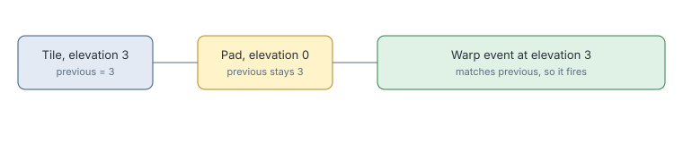

# Navigator elevation-zero pads

> Markdown twin of [navigator-elevation-zero-pads-v1.html](../navigator-elevation-zero-pads-v1.html), generated from the HTML by `just explainer-twins`. The HTML is the source; edit it, not this file.

`navigator-elevation-zero-pads-v1` matches warps against the elevation the game actually uses, so warps on elevation-0 tiles stop being refused.

## Why it exists

Lavaridge Gym 1F's pads sit on elevation-0 tiles, with warp events at elevation 3. The navigator compared the tile's elevation and answered "target is not listed", though the runs reached those pads by hand. This was 20 of 48 such refusals across four DeepSeek runs.

## The game's rule

*From pret: PlayerGetElevation returns previousElevation, and ObjectEventUpdateElevation leaves it alone on elevation-0 tiles and on a step onto a multi-level tile.*

## What does not change

Routes. The planner's steps are the same; only which warps the navigator accepts changes. If the player is already standing on an elevation-0 tile, the previous elevation is not known, so a warp is not ruled out.

## Off

The current elevation is compared.
