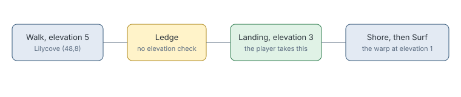

# Navigator ledge drops and surf starts

> Markdown twin of [navigator-ledge-drops-v1.html](../navigator-ledge-drops-v1.html), generated from the HTML by `just explainer-twins`. The HTML is the source; edit it, not this file.

`navigator-ledge-drops-v1` lets the planner take ledges that land at another elevation. `navigator-surf-start-warps-v1` lets the warp lookup see a warp only the water reaches. Together they end the "not listed" refusals at Lilycove's cove cave.

## Why it exists

Sixteen recorded refusals named the warp at Lilycove (70,5). It looked like a Surf problem, but the planner could not even reach the beach: the way there is a ledge from elevation 5 down to elevation 3, and the planner refused any landing at a different elevation. The game does not check that, and the KeepingItIcy run took those ledges.

## The game's rule

*From pret: ShouldJumpLedge reads only the ledge's behavior. Surf starts only from elevation 3.*

## How much changes

28 of the ROM's 789 walkable ledges land at another elevation, on Route 115, Lilycove City, Route 120 and the Safari Zone. Across 1,228 recorded navigation calls, 29 plans changed, every one from no route to a route. None got longer or was lost.

## What does not change

The harness still never uses Surf. Navigation stops at the shore, facing the water, and tells the model to press A.

## Off

Ledges with a different landing elevation are no route, and a warp across water is refused as not listed.
