Harness switch · no-nickname-guidance-v1 · bundle · default OFF

# Speed runs skip nicknames

> Markdown twin of [no-nickname-guidance-v1.html](../no-nickname-guidance-v1.html), generated from the HTML by `just explainer-twins`. The HTML is the source; edit it, not this file.

One system-prompt paragraph: a nickname only costs time, so answer NO when the game offers one, and if the naming screen is already open, leave it with START then A.

## What went wrong

Showcase bundle run `2026-10-16T00-34-26_qwen36-gpu1_show`: PROF. BIRCH asked "why not give a nickname to that TORCHIC?" at turn 252. The model answered YES and spent the next 78+ turns (more than seven minutes) trying to spell "MOM". Nothing in the prompt said a nickname does nothing for progress.

## The two ways out



Orange is what the paragraph asks for. Either path ends back in the lab with the Pokémon still called TORCHIC.

## The exact paragraph (ON)

```
Nicknames: this is a speed run, and naming a Pokémon only costs time. When the game offers to give a Pokémon a nickname, answer NO. If you are already on the naming screen for a Pokémon's nickname, do not type or fix letters: press START to move the cursor to OK, then A. Any nickname is fine, and with nothing typed the Pokémon keeps its own name.
```

Added after the game-evidence guidance and before the map-rules, battle-triage, talk-to-people and objective sections. OFF: the prompt is unchanged.

## Checked on the real game

| From Birch's question, YES | Result in the party |
|---|---|
| START, A (nothing typed) | nickname `TORCHIC` |
| A, START, A (one letter typed) | nickname `A` |

Live game server loaded at Birch's nickname question. An empty name keeps the Pokémon's own name because the game copies the typed text only when it has a non-space character (pret/pokeemerald `naming_screen.c`, `SaveInputText`).

## Status

- **Not done**: No measured runs. The experiment entry is pending, not queued.
