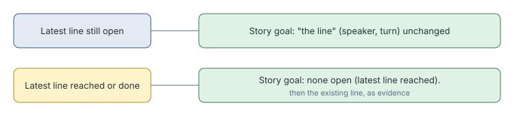

# No open story goal

> Markdown twin of [no-open-story-goal-v1.html](../no-open-story-goal-v1.html), generated from the HTML by `just explainer-twins`. The HTML is the source; edit it, not this file.

`no-open-story-goal-v1` makes the readout say outright when no story goal is open. It gives no hint about what to do next.

## Why it exists

After the Magma Emblem in run a0b4, the latest place-naming line was ARCHIE's, about MT. PYRE, a place the run had already reached. The readout printed it as a heard line, so nothing said plainly that no goal was open.

## What it prints

*A done line prints the plain line alone, so its retired quote stays gone. The line prints from the first arrival at the place. A newer place-naming line opens a goal again.*

## Off

A reached line prints alone, and a done line prints or is left out as before.
