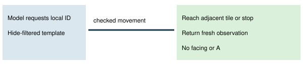

# Approach an unloaded trainer template

> Markdown twin of [npc-approach-feedback-v1.html](../npc-approach-feedback-v1.html), generated from the HTML by `just explainer-twins`. The HTML is the source; edit it, not this file.

The template says where the map places this object. It may have moved. Current presence and position remain unverified until a live object slot is available. This treatment never presses A for a template.

## Evidence and limits

Reuses heal-before-trainers-v2 map trainer facts. The reader checks the native template hide flag and current map. The model supplies the exact local ID. Checked navigation keeps field ownership, trainer sight, obstacles and map interruption guards. Matching triggers and warp destinations are avoided when selecting the adjacent approach.

When the object loads, the map changes, an interface opens or template evidence disappears, return to the model. The model decides its next interaction. Loaded targets retain their existing semantic behavior and occupied-person approach alternatives.

Non-trainer unloaded objects are unsupported here: their hide-filtered template coordinates are not in the typed state. No coordinate, leader location, movement type or presence is invented.

Source: pret/pokeemerald event_object_movement.c TrySpawnObjectEvents and field_control_avatar.c GetInteractedObjectEventScript, revision 731ad5bfd6e6f265508d0efcca0ba42f9dcf5881. OFF preserves previous refusals. ON is bundle only, default OFF. Synthetic correctness checks do not establish gameplay benefit. No runs launched.
