Harness switch · observation · `offscreen-objects-v1` · needs `live-object-sprites-v1` · off by default

# Off-screen people and objects

> Markdown twin of [offscreen-objects-v1.html](../offscreen-objects-v1.html), generated from the HTML by `just explainer-twins`. The HTML is the source; edit it, not this file.

The readout shows only a 15×15 window around the player. With the switch on, a new block lists every person and object the current map places outside that window, each with its sprite kind and tile. With story character presence on, an out-of-view story character such as MAY gets her tile too.

## 1. The problem in cook run #2

Run `2026-10-16T02-23-17_qwen36-gpu1_sh02` spent 540 turns on Route 103 (turns 415 to 955). At turn 416 the player stood at (11,21). The local map and the Field objects list cover the player's tile ±7, so x 4..18 and y 14..28. MAY's object sits at (10,3), 18 rows north of the player and outside that box.

The readout said only `MAY (on this map, out of view)`. It named no tile. The model pursued an east exit. MAY was first named with coordinates at turn 754, when she was inside the window.



*Turn 416 (raw RAM 00004588). Blue box: what the local map and Field objects list can show. Red: MAY's template tile, which the OFF readout never gave. Grey: the other objects the ON block lists. Object positions are template tiles; none was loaded at this turn.*

## 2. Off and on, same turn

Both readouts are re-rendered from the run's recorded RAM and the real ROM with that run's switches. OFF equals what the model got. ON removes one line and adds the block plus a new story line. Nothing else changes.

Off (what the model got at turn 416)

```
Field objects (ids are map-local, not globally unique; sprite kinds are not personal names):
…
Story characters here (from this map's own object list): MAY (on this map, out of view). Not on this map: PROF. BIRCH, BRENDAN, MOM, NORMAN, WALLY, ROXANNE, STEVEN. …
```

On

```
Field objects (ids are map-local, not globally unique; sprite kinds are not personal names):
…
Off-screen people and objects on this map (from the map's own object list; more than 7 tiles from you, so the Field objects list leaves them out):
- map 0/18 object 1: sprite MAN_3 (graphics 33) at (49,12), not loaded; where the map places it, it may have moved
- map 0/18 object 2: sprite RIVAL_MAY_NORMAL (graphics 105) at (10,3), not loaded; where the map places it, it may have moved
- map 0/18 object 3: sprite WOMAN_2 (graphics 20) at (71,11), not loaded; where the map places it, it may have moved
  … objects 4 to 10 and 12 to 20, same form (19 entries in all; no object 11)
Story characters here (from this map's own object list): MAY at 10,3 (out of view; where the map places this character, it may have moved). Not on this map: PROF. BIRCH, BRENDAN, MOM, NORMAN, WALLY, ROXANNE, STEVEN. …
```

On, nothing outside the window

```
Off-screen people and objects on this map: none.
```

A loaded object that is off the window ends `loaded off screen, its tile now` instead of `not loaded; where the map places it, it may have moved`. A loaded story character's line reads `MAY at x,y (out of view)`.

At turn 754 (raw RAM 00005144) MAY is inside the window. Field objects already lists her at (10,3), and the story line already reads `MAY at 10,3`, so the ON block leaves her out.

Placement: the block goes after Field objects and the other world-context lines, and before Story characters. It appears only when `live-object-sprites-v1` is also on.

## 3. How each object is decided

The reader walks the map's 64 object template slots in the save block. For each slot it asks the questions below in order.



*One pass per template slot. Red boxes drop the object. Blue boxes pick the tile. Only objects that survive to the green box are listed. The window test uses the same ±7 as the local map and Field objects list.*

| Game data | Where | What is read |
|---|---|---|
| `SaveBlock1.objectEventTemplates` | offset `0xC70`, 64 slots × 24 bytes | localId +0, graphicsId +1, x and y as s16 at +4/+6 (map coordinates, same frame as Position), flagId at +0x14 |
| Event flags | `SaveBlock1` + `0x1270` | a set flag hides the template (as `TrySpawnObjectEvents` does with `FlagGet`) |
| `gObjectEvents` | 16 bodies × 0x24 bytes | active bit, map group/num, local id, invisible bit, current coords at +0x10 (minus the map offset of 7) |

Grounding: pret/pokeemerald `include/global.fieldmap.h` (`struct ObjectEventTemplate`) and `include/global.h` (`SaveBlock1`). Scripts that move an object for good call `SetObjectEventTemplateCoords`, so a template's x,y is where the map places it now. A moving NPC can still wander from it, which is why the text says it may have moved. Graphics ids that use a variable (`VAR_OBJ_GFX_ID_0`…) are resolved first, as Story characters does.

## 4. Proof on the recorded run

Every cook run #2 tool result from turn 415 to 960 that has raw RAM (546 of them) was re-rendered with the switch off and on.



*Bar length is the share of the 546 re-rendered results. The block is read only on overworld turns outside battle, so many results (battles, menus, dialogue) never carry it.*

The tests (`env/tests/env/test_offscreen_objects.py`, fixture `offscreen-objects-sh02.json`) pin the two turns: at turn 416 OFF is contained in the received text and ON changes only the story line and the new block; BIRCH's object 11 is absent; at turn 754 MAY is not repeated. Synthetic RAM tests cover loaded, invisible, flagged, variable-graphics and invalid-pointer cases.

## 5. Wiring



*The highlighted box is the one that changes what the model sees. With the switch off, `GameState.offscreen_objects` is `None`, the RAM is never read and the story line keeps "(on this map, out of view)". The field is not added to the state JSON, so recorded state is unchanged.*

## 6. Status

- Milestone M1. Registered in `packages/agent/src/features.ts` as an observation switch that needs `live-object-sprites-v1`. Default off in both stacks.
- Gates at M1 GREEN: agent, viewer and Python tests pass with the ROM; `offscreen_objects`, `character_presence` and `readout` at 100% Python coverage.
- Operator wants it in the bundle-v-control bundle arm. The readiness thread edits the bundle file; this branch does not.
- Not done: multi-model review, viewer card link, measured runs. No claim that it helps.
