Harness switch · one-way-tiles-v1

# The bedroom chair has walls on two sides

> Markdown twin of [one-way-tiles-v1.html](../one-way-tiles-v1.html), generated from the HTML by `just explainer-twins`. The HTML is the source; edit it, not this file.

The chair in the player's bedroom has no collision, so the map drew it as plain floor (`.`). The game still refuses every step across its north and south edges, into it or out of it. With this switch on, the map draws it as `+`, lists its walled sides, and `navigate_to` only uses its open sides.



One tile, four edges. Red edges refuse a step in either direction; green edges behave like floor.

## The same move in the bedroom

Real live-map tiles from `tests/states/house2_upstairs.state` (Littleroot, May's house 2F, map 1/3). The chair is at (7,4). Going from (7,3) to the chair.

### OFF Chair drawn as floor

Refused DOWN from (7,3) does not move



The grid promises a clear tile, so the obvious move is DOWN. The game refuses it. `navigate_to` treats the tile as a wall: "no supported local path".

### ON Chair drawn as `+`

3 presses LEFT DOWN RIGHT


The planner refuses the walled north edge and enters from the open west side. Recorded live: "arrived at requested coordinate; 3 ordinary button attempts".

## What the model reads

```
     -1   0   1   2   3   4   5   6   7   8
   3  ?   .   .   .   .   .   .   .   .   .
   4  ?   .   @   .   .   .   .   .    +  .
   5  ?   .   .   .   .   .   .   .   #   .
… # collision; g grass; ~ water; v ^ < > ledge: …;
+ edge walls: walkable, but movement across a walled side is refused in both directions (sides listed under Edge walls);
. clear terrain (may have script triggers); ? outside current map.
Terrain rules, elevation and objects can still block movement.
Edge walls: (7,4) north+south
```

Excerpt of the live readout on the real ROM (rows trimmed). Off: the cell is `.`, and the legend clause and the Edge walls line are gone. The Edge walls line appears only when such a tile is within 7 tiles, and it still lists the tile while the player stands on it (the cell then shows `@`).

## The game's rule: two checks per step



That is why one walled side blocks both directions: leaving through it fails the first check, entering through it fails the second. `planNavigation` runs the same two checks.

## Which tiles count

| Behavior | Value | Walled sides |
|---|---|---|
| `MB_IMPASSABLE_EAST / WEST / NORTH / SOUTH` | `0x30–0x33` | that one side |
| `MB_IMPASSABLE_NORTHEAST / NORTHWEST` | `0x34, 0x35` | north+east, north+west |
| `MB_IMPASSABLE_SOUTHEAST / SOUTHWEST` | `0x36, 0x37` | south+east, south+west |
| `MB_SECRET_BASE_BREAKABLE_DOOR` | `0xBE` | west+east |
| `MB_IMPASSABLE_SOUTH_AND_NORTH` (the chair) | `0xC0` | north+south |
| `MB_IMPASSABLE_WEST_AND_EAST` | `0xC1` | west+east |

From `MetatileBehavior_Is{North,South,West,East}Blocked`, pokeemerald 731ad5b. A tile with collision keeps `#` and is not listed.

## How the switch travels



Highlighted boxes change behavior. The typed state JSON keeps the full map text either way; the switch changes only what the model reads and how the planner walks.

## Status

- A working branch in its own worktree, merged with main after ledge hops landed.
- Agent 914, viewer 476 and env 1823 tests pass at the branch head after merging main; coverage floor 90% and lint pass.
- Live on the real ROM, plus a recorded probe run on and off: the game refuses DOWN into the chair from (7,3) and UP/DOWN off it; `navigate_to` enters from the west in 3 presses.
- Review round 1: Claude and Grok LGTM; Codex blocked only on this explainer being missing from the branch. Their test and copy fixes are applied: in TypeScript every one of the 11 behaviors is tested entering and leaving through every side, and in Python each one is tested for its listed sides.
- Review round 2 on the fixes: Claude, Codex and Grok all LGTM.
- Not done: no measured runs, so no claim that this helps a model. Not merged to main.
- Seen but out of scope: the bedroom floor behaviors are outside the planner's walkable list, so `navigate_to` detours elsewhere in this room. The walkability thread owns that.
