Harness switch · guidance · `open-goal-prompt-v1` · needs nothing · off by default

# Open goal prompt

> Markdown twin of [open-goal-prompt-v1.html](../open-goal-prompt-v1.html), generated from the HTML by `just explainer-twins`. The HTML is the source; edit it, not this file.

One sentence of the system prompt changes. Today the goal sends the model toward "the first Gym Leader in Rustboro City", a town the game itself does not name until Route 104. With the switch on, the goal names no town, gym or leader: play the game, and the people in it will say what to do next. Every other byte of the prompt stays the same.

## Why: run 4caa, turn 273

Run `2026-10-16T12-42-29_qwen36-gpu0_4caa` (bundle arm, cook phase) had just beaten MAY on Route 103, 9/25 HP left. Its reasoning at turn 273:

```
I have defeated MAY. My Torchic is at 9/25 HP. The dialogue indicated I should head back to the LAB (Rustboro City).
```

The lab is in Littleroot. No tool result or dialogue page in that run ever named Rustboro. Its first turn already read "head towards the first Gym Leader in Rustboro City": the goal sentence was the only source. The operator (2026-10-16): "I have a feeling that this is because of the system prompt where we're telling it to reach the first gym."

## The one sentence that changes

OFF (today)

```
You are playing Pokémon Emerald on a Game Boy Advance emulator. Your goal is to make as much story progress as you can: start a new game, get your first Pokémon, and work toward defeating the first Gym Leader in Rustboro City.
```

ON

```
You are playing Pokémon Emerald on a Game Boy Advance emulator. Your goal is to play the game and make as much story progress as you can; the people in the game will tell you what to do next.
```

The rest of the prompt (tools, controls, dialogue, warps, game evidence, moving around, map rules, battles, trainer heal, explorer, untaken exits) is unchanged; a test checks that ON equals OFF with only this sentence replaced, on run 4caa's recorded prompt. A run with a target milestone keeps "Your goal is: Reach the native game milestone …" either way.

## When the game itself names these places



*Story order, not to scale. Game sources from the human run `human/2026-10-13T23-50-13_human_1848`: Route 104's north connection reads RUSTBORO CITY at 12:20 AM, and Petalburg Woods dialogue says "…they were after something in RUSTBORO, too?" at 12:32 AM. No model run has got that far yet.*

## How often models named Rustboro before the game did

Every model run started on 2026-10-15, or on 2026-10-16 before 3:00 PM New York (lanes qwen36-gpu0, qwen36-gpu1, think-fast): 67 runs, 33,307 turns, each scanned up to a recorded cutoff event. All had the Rustboro goal sentence. No tool result or dialogue page in any of them named Rustboro, so every mention below came before the game named it. Model reasoning named Rustboro in **26 of 67 runs** (900 turns).



*Counts from the runs' own events (assistant thinking and text versus tool results and dialogue pages), per run in `docs/experiments/open-goal-prompt/manifest.json`; `scan.py check` rescans each run to its recorded cutoff. Wall caps in brackets: cook runs 2919 and 3f21 had 12 minutes, the other cook runs 60. Cook runs start from the MAIN_MENU save, factorial and dry runs from CLOCK_SET, finals from boot. "Lab in Rustboro" outright: 2 runs, 113 turns (think-fast `0875`: "Professor Birch's lab in Rustboro City?", and 4caa T273). A gym was named before the game's TV line in 8 of 67 runs; 4 runs named the goal's gym or Rustboro at turn 1. The cohorts differ in many switches, so the bundle/control gap is descriptive only.*

## What to watch in the bundle arm (pre-registered)

This switch joins the bundle arm of bundle-v-control (the operator, 2026-10-16). The diagnostic below was fixed before any run with the switch on. It checks the mechanism; it is not causal evidence and it grades nothing.

- **Rustboro before the game:** per run, the number of turns whose reasoning names Rustboro before any tool result or dialogue page did. Baseline: bundle cook runs, 11 of 12 runs, 736 turns. Expected with the switch: near zero; any left come from the model's own memory of the series.
- **Gym before the game:** runs whose reasoning names a gym before Mom's TV line. Baseline 8 of 67 runs.
- **After the rival battle:** what the reasoning names as the next destination once MAY is beaten (Birch's lab in Littleroot is the game's next step).

Grading cannot depend on the wording: milestones come only from native game flags and variables (`story.py`, `milestones.ts`), never from the prompt.

## Other places the model can read Rustboro or a gym

| Where | On in the bundle? | Decision |
|---|---|---|
| System prompt goal sentence | yes | Replaced by this switch. |
| The goal the objective record carries (`objective-tracking-v1`) and the state-only prompt (`state-only-decisions-v1`) | no | Replaced too, so ON never names a town, gym or leader as the goal whatever else is on. |
| `next-milestone-hint-v1` ladder (Petalburg Gym, Rustboro City, Roxanne) | no | Left alone: a walkthrough treatment by design, shown one milestone at a time. |
| Objective completion vocabulary (`RUSTBORO_GYM_COMPLETE` …) | no | Left alone: a grading vocabulary in a tool schema, not a goal. |
| Readout story lines, character presence, sign names ("Petalburg Gym TV report", "Gym Sign", ROXANNE in her gym) | yes | Left alone: each appears only after the game state or the current map shows it. The scan found no tool result naming Rustboro in 67 runs. |
| Every other prompt section | yes | No Rustboro, gym, leader or badge (checked on run 4caa's recorded prompt). |

## Wiring


*Agent side only; the game server is untouched. The switch is recorded last in the run's harness features.*

## Status

- Tests: registry and presets default OFF, OFF equals run 4caa's recorded prompt byte for byte, ON replaces only the goal sentence, target runs unchanged, objective and state-only goals, factory path, the pending entry's incumbent equals the bundle arm.
- Pending experiment `experiments/open-goal-prompt.json` (incumbent: the bundle-v-control bundle cook arm, MAIN_MENU save, 60-minute cap). It is marked `blocked` so the queue never offers it as a standalone experiment. Not measured. Adding it to the bundle arm is an edit to `experiments/fixed/bundle-v-control.json` that this branch does not make.
