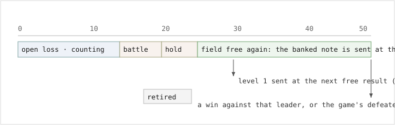

# open-milestone-stall-v1

> Markdown twin of [open-milestone-stall-v1.html](../open-milestone-stall-v1.html), generated from the HTML by `just explainer-twins`. The HTML is the source; edit it, not this file.

guard

default OFF

**One line:** while the last GYM LEADER battle this run is still a loss, every 30 actions the loop guard sends one supervisor note that names the trainer, the place and turn of the loss, the party the readout showed when that battle started, and the party now.

Needs `stall-briefing-v1`. Facts only: no route, no destination, no next step, no advice on which POKéMON to train.

## Why

Same run: `2026-11-02T14-53-03_hyperqwen-gpu0_de7a`. Four drought ticks were due in the stall window and one note was delivered. Three were recorded as `Not sent (drought-progress-facts-v1) … but a battle is on screen` (turns 177, 411, 466), and each of those holds restarts the clock, so a battle-dense grind can never mature it.

| Stall machinery, this run | Fired | What it said |
|---|---|---|
| `stall-briefing-v1` + `turn-drought-clock-v1` | 1× at turn 378 (17:53) | "No new story milestone, level-up, trainer win or full heal in the last 30 actions" |
| `drought-progress-facts-v1` hold | 3× suppressed | "Not sent … but a battle is on screen", clock restarted |
| `unfinished-activity-v1` | 153 results | "Still open: ROXANNE … you lost at turn 342" |
| `leader-attempt-ledger-v1` | never | gym-map or leader-decision gated; the bot never went back |

## What the model gets

```
SUPERVISOR: You have an unfinished battle: you lost to ROXANNE on RUSTBORO CITY GYM
(map 11/3) at turn 342, and 30 actions have passed without another attempt
(stall briefing, 344 calls into the run).
- Party at that battle: TORCHIC Lv14, EXP. POINTS 1724
- Party now: TORCHIC Lv15, EXP. POINTS 2064
Stop and get your bearings:
- Where you are: ROUTE104 (map 0/19) at 12,6 facing down
...
```

## Counting, holding, retiring



## Exact rules

- Same attempt capture and open/retire rules as `drought-progress-credit-v2`: attempt at a `battle_active` opponent whose `trainer_class` is `LEADER_CLASS`; open on `lost` or `drew` from `BattleOutcomes`; retired by a later `won` or the game's `defeated` flag.
- One action counter per open record, incremented per tool result and reset only when the record opens or retires. It is *not* reset by a battle, a heal trip or a level-up.
- At each 30-action threshold, if the field is free (no battle on screen, no unbeaten trainer's sight script, no open heal trip) and no other supervisor note is outstanding, one `open_milestone` note is requested. If the field is held, the request waits; the count keeps running.
- While the record is open this note replaces the drought briefing. Map-cycle and interface-dwell notes are unchanged.
- One outstanding note at a time: `LoopDetector.stall` refuses while a loop briefing, another note or a navigation recovery is open, and the counter does not advance past the threshold.

## Wiring

```
experiments/feature-configs/current.json   (bundle switch list)
  -> packages/agent/src/features.ts        SWITCHABLE_FEATURES, FEATURES, playHarnessFeatures
  -> packages/agent/src/play-preset.ts     schema, normalizeFeatures (??false), flagFeatures (false)
  -> packages/viewer/src/next-run.ts       DEFAULT_NEXT_RUN: false
  -> packages/agent/src/loop/types.ts      StallKind += "open_milestone"
  -> packages/agent/src/loop-supervisor.ts Stall union + stallText branch
  -> packages/agent/src/events.ts          loop_guard kind enum
  -> packages/agent/src/stall-briefing.ts  counter + check() block   <-- the one box that changes behavior
  -> packages/viewer/src/{model,trace}.ts  label for the new kind
```

## Status

Branch `main`. Tests: "briefs once on an open leader loss after 30 actions…", "banks a due open-milestone note through a battle and sends it at the next free result", "stops briefing once the leader is beaten", "sends no open-milestone note with the switch off"; deleting the `stall("open_milestone", …)` call turns the first two red. **ON in the bundle arm since the 2026-11-02 recipe revision** with its prerequisite `stall-briefing-v1`; the control arm keeps it off and the pinned control base still matches. Not yet measured: a running trial materializes its preset once, at launch, so the trial that carries it is the next fixed-run launch.
