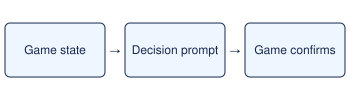

# Catch Rayquaza

> Markdown twin of [opus-rq-catch-v1.html](../opus-rq-catch-v1.html), generated from the HTML by `just explainer-twins`. The HTML is the source; edit it, not this file.

Opus Rayquaza lane · assisted JIT guidance · default OFF

*Opus receives the prompt as the last message while the decision is due. It chooses and executes the action.*

## When it fires

Sootopolis crisis resolved and Master Ball held.

## What Opus sees

Return to Sky Pillar. At the summit, approach (14,7), face north and use the Master Ball on Rayquaza.

## When it stops

Rayquaza is in the party.

With mach_dash enabled and the Mach Bike registered, the prompt gives the exact input sequence at each verified Sky Pillar starting tile. It tells Opus when to mount with SELECT and explains the intentional 4F drop to the 3F pocket. If the catch goes to storage, the prompt asks the model to withdraw Rayquaza.

## What the switch changes

ON adds this scoped prompt and records its activation in Activity History. OFF omits the prompt. A run with any of the four decisions enabled is classified as heavily assisted.
