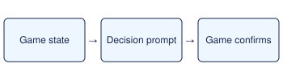

# Get and register the Mach Bike

> Markdown twin of [opus-rq-mach-bike-v1.html](../opus-rq-mach-bike-v1.html), generated from the HTML by `just explainer-twins`. The HTML is the source; edit it, not this file.

Opus Rayquaza lane · assisted JIT guidance · default OFF

*Opus receives the prompt as the last message while the decision is due. It chooses and executes the action.*

## When it fires

Free field in Mauville or Rydel’s shop.

## What Opus sees

Mach Bike acquisition and SELECT registration.

## When it stops

Bike state confirms MACH BIKE is on SELECT.

Ordinary bike navigation, registration and auto-mount are independent execution switches in this preset. The prompt never chooses a button or mounts the bike.

## What the switch changes

ON adds this scoped prompt and records its activation in Activity History. OFF omits the prompt. A run with any of the four decisions enabled is classified as heavily assisted.
