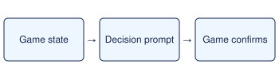

# Pick up the Master Ball

> Markdown twin of [opus-rq-master-ball-v1.html](../opus-rq-master-ball-v1.html), generated from the HTML by `just explainer-twins`. The HTML is the source; edit it, not this file.

Opus Rayquaza lane · assisted JIT guidance · default OFF

*Opus receives the prompt as the last message while the decision is due. It chooses and executes the action.*

## When it fires

Free field in Aqua Hideout B1F with a readable bag.

## What Opus sees

From (3,15), take the warp at (3,20), followed by (42,5), (45,9), (42,13), and (42,17). Approach the Master Ball at (15,9) from below before pursuing the submarine.

## When it stops

Bag or pickup milestone confirms acquisition.

The prompt identifies the two decoys on the right. The pickup flag or the submarine escape retires the prompt.

## What the switch changes

ON adds this scoped prompt and records its activation in Activity History. OFF omits the prompt. A run with any of the four decisions enabled is classified as heavily assisted.
