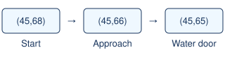

# Dive and native screen correctness

> Markdown twin of [opus-trace-correctness-v1.html](../opus-trace-correctness-v1.html), generated from the HTML by `just explainer-twins`. The HTML is the source; edit it, not this file.

## Underwater movement

The avatar's native Dive flag selects underwater movement, including the step onto a listed water door. The surface Surf flag can remain set during the handoff.

*Recorded northward approach in Opus run 69d8.*

## Native screen ownership

Warp and Dive handoffs show a field transition while the game owns movement. Credits and THE END have separate readouts. Credits recognition leaves the run's completion policy alone.

After a party field move is refused, the active party task and its drawn message window identify the text and acknowledgement input.

## Settings

Both current arms enable the correction. With the switch off, existing presets retain their previous navigation and readouts.
