Game-clock switch · original-speed-pacing-v1 · default off

# Original-speed deadline pacing

> Markdown twin of [original-speed-pacing-v1.html](../original-speed-pacing-v1.html), generated from the HTML by `just explainer-twins`. The HTML is the source; edit it, not this file.

The operator goal is an actual 80 core frames per second during normal play. The switch changes the game-loop clock policy; it does not promise that frame publication, WebSocket delivery, SVG image-load completion, or compositor paint also run at 80.

### ON · original-speed target

80 FPS · 12.500 ms

Each absolute deadline is 12.5 ms after the previous one. Work consumes that budget; sleep uses only the remainder.

### OFF · current comparison clock

59.7275 FPS · 16.743 ms

The same deadline algorithm keeps the existing Emerald real-time base. Historical presets that omit the switch remain OFF.

## Why the deadline matters

The pinned vendor asks for 80 FPS, advances a frame, performs its work, and then sleeps for a full `1 / current_fps`. That makes the real period *work + requested sleep*. Deadline pacing instead schedules the next frame boundary first and subtracts elapsed work from the available sleep.

*Figure 1. A target rate becomes a frame budget only when frame work is inside the period. The diagram shows scheduling policy, not a measured throughput result.*

## The 4× selector is conditional—and currently inactive

The vendor function returns four times the base rate only when its cached dialogue flag is true. With the switch ON that request would be 320 FPS. Production launches the server with `--no-ocr`, which disables the vendor dialogue detector, and no owned replacement currently drives that cached selector. Therefore 320 is preserved as a conditional ratio, not proven natural-dialog behavior.

**Not part of this claim:** synthetic 320 Hz transport stress does not show that normal production dialogue selects 320. Enabling a RAM-owned selector would be a separate behavior change with separate tests and review.

## Five rates, five different questions

*Figure 2. The switch controls only the first box. Today’s publisher has its own 60 FPS cap, so an 80 FPS game-core result cannot be reported as an 80 FPS viewer result.*

## What the switch changes

- **ON:** the thread-local game-loop clock uses an 80 FPS base deadline. A vendor period change starts a fresh cadence; a delay beyond four periods resets the schedule rather than creating an unbounded catch-up burst.
- **OFF:** the same deadline machinery uses the existing 59.7275 FPS base exactly. The human reference always retains this nominal clock, matching its recorded timing policy.
- **Recorded identity:** the explicit selection belongs in the run’s harness-feature list so historical OFF runs and future ON runs remain distinguishable.
- **Unchanged:** prompts, tools, observations, controls, publication cap, frame transport, and browser rendering.

## Status

**Candidate only: unreviewed and unlanded.**

This page documents the intended contract. It is not proof that the candidate is on main, deployed, or sustaining 80 FPS. Publication-at-80 comparison and direct paint evidence are still pending.

## Source grounding

`env/vendor/continual-harness/server/app.py` sets the base to 80 and sleeps for `1 / current_fps` after frame work. `env/vendor/continual-harness/pokemon_env/emulator.py` defines the cached 4× selector. `env/pokebench_env/launcher.py` passes `--no-ocr` in production. `env/pokebench_env/frame_pacing.py` owns the thread-local absolute-deadline adapter, the 59.7275 constant, period-change handling, and the four-period lateness bound. `env/pokebench_env/serve.py` separately caps frame publication at 60 FPS.
