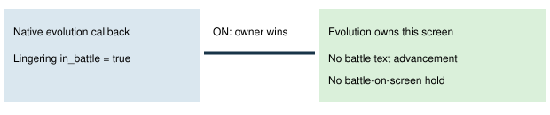

# The current screen owns input

> Markdown twin of [owned-battle-context-v1.html](../owned-battle-context-v1.html), generated from the HTML by `just explainer-twins`. The HTML is the source; edit it, not this file.

The native battle bit can remain set while evolution or move-forget callbacks own the screen. The switch respects explicit ownership without changing the decoded state.

## Actual recorded example

d951 state 17459: evolution callback 0x0813E3A5, task 0x0813E571, task state 15, move-learning state 11. The owned result is COMBUSKEN did not learn DOUBLE KICK. Raw archive 00007494 at frame 273486 has SHA-256 3b69dfa0e60f653a9ae486a1348eb345f527c10fc8e30828c767ce1de0a55f09. Warning 17461 called this a battle on screen.

Source: pret/pokeemerald evolution_scene.c Task_EvolutionScene and Task_TradeEvolutionScene; pokemon_summary_screen.c move-forget ownership. Revision 731ad5bfd6e6f265508d0efcca0ba42f9dcf5881.

## Switch contract

ON excludes explicit evolution and move-forget owners from drought battle holds, battle text settling and decision-readiness waits. Genuine battle screens and unknown owners retain their existing battle handling. OFF preserves previous detection and hold reasons. Default and control OFF; bundle ON.

Evolution and move-learning tools retain all model choices. This switch presses no input and does not repair an unreadable menu by guessing. Independent drought suppression remains separate: when both are ON, a drought diagnostic may still be recorded without a model instruction.

Tests and raw-RAM replay establish correctness. No gameplay benefit, experiment run, live viewer restart or launch is claimed.
