# Party item confirmation

> Markdown twin of [party-item-confirmation-v1.html](../party-item-confirmation-v1.html), generated from the HTML by `just explainer-twins`. The HTML is the source; edit it, not this file.

A completed Potion message can wait for a button while its printer task stays active. This correction reads that wait directly.

## What changes



The switch changes only the reported readiness. It never presses a button.

## Retained evidence

Run `2026-10-20T14-04-18_qwen38-mac_28f3`, archive 6507, native frame 842563. Matching ROM SHA1 `f3ae088181bf583e55daf962a92bb46f4f1d07b7`. The complete message is “TORCHIC’s HP was restored by 20 point(s).” Archives 6468 and 6472 reproduce the same wait.

### OFF — unchanged

```
Interface: party_item_message; input not ready; Game-owned item animation/message or menu handoff in progress
```

### ON — native button wait

```
Interface: party_item_message; input ready; selected A/B: CONTINUE; A or B continues the message
```

## Game grounding

pret/pokeemerald `731ad5bfd6e6f265508d0efcca0ba42f9dcf5881`: `gText_PkmnHPRestoredByVar2` ends in `PAUSE_UNTIL_PRESS`. `Task_PrintAndWaitForText` runs until the printer finishes; `Task_ClosePartyMenuAfterText` waits for that task. `TextPrinterWait` accepts A or B unless auto-scroll owns it.

Window 6 printer at `0x02020288`, stride `0x24`, active byte +0x1B, render state +0x1C. A current-message pointer ending just after FC 09 binds the wait to the message. Invalid ownership remains diagnostic.

## Wiring and status

Run feature selection → server feature set → shared state reader → active interface → model readout and recorded JSON → existing viewer/replay interface fields.

`party-item-confirmation-v1` defaults OFF and is enabled only in the bundle arms of `bundle-v-control` and `bundle-cook-1h` (operator approval 2026-10-20). Candidate a working branch. Regression tests include native memory and exact OFF output. Full gates, independent review and landing are recorded in the worklog. Active presets and recordings remain unchanged. No measured performance benefit or runtime activation is claimed.
