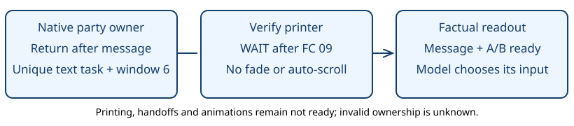

# Party menu message

> Markdown twin of [party-menu-message-v1.html](../party-menu-message-v1.html), generated from the HTML by `just explainer-twins`. The HTML is the source; edit it, not this file.

`party-menu-message-v1` · default OFF · item 5

## The game was waiting for acknowledgement

GLM run 0d5d, event 39808, turn 390: the screen showed “MUDKIP has no energy left to battle!” The old readout said “Dialog: none” and “input not ready”. This switch exposes the game’s message and its verified A/B wait. It never presses a button or chooses a Pokémon.

On a narrow screen, scroll the diagram horizontally.



## OFF and ON at the retained frame

### OFF: preserved

```
Dialog: none
party_return_after_message
input not ready
```

### ON: corrected

```
Dialog: “MUDKIP has no energy left to battle!”
party_return_after_message
input ready; selected A/B: CONTINUE
```

After acknowledgement, the ordinary cursor reads `PARTY SLOT 1 (index 0): MUDKIP (fainted)`. Both numbering systems are explicit. The JSON retains `party_slot` as zero based and adds `cursor_party_index`, `cursor_party_number`, `cursor_species`, and `cursor_fainted` when the selected party record is valid. A switch or Soft-Boiled second cursor names that cursor; an action menu keeps its selected action.

Confirm, Cancel, empty slots and unavailable or invalid party records never acquire guessed species. The species comes from the existing decoded party snapshot; the game message comes from the owned text buffer. No new tool or system-prompt section is added.

## Source and limits

pret/pokeemerald `731ad5bfd6e6f265508d0efcca0ba42f9dcf5881`, US ROM SHA1 `f3ae088181bf583e55daf962a92bb46f4f1d07b7`. `party_menu.c: Task_ReturnToChooseMonAfterText` waits on `Task_PrintAndWaitForText`; `strings.c: gText_PkmnHasNoEnergy` ends with `{PAUSE_UNTIL_PRESS}`; `text.c` consumes FC 09 before polling A/B. Exact retained RAM fixtures 8361 (paired with event 39808) and 8367 cover the message and post-A cursor; 8360 is an earlier matching wait.

This switch corrects that return-message phase. Existing item-confirmation behavior remains under its own switch. It does not claim every party message phase is supported or that the correction improves gameplay. Turn 390 (cursor) and turn 391 (first decision after event 39808) cases have an offline plan and native fixtures. The existing replay tool cannot rebuild their full counterfactual contexts because an earlier result auto-advanced dialogue. No contexts or model results are invented; the operator waived separate safety probes before this activation.

## Status

Implementation and focused regressions on a working branch. Full gates, frozen cloud review, landing and served proof are recorded separately in the worklog. Registry and preset defaults remain OFF. The operator approved bundle ON / control OFF in bundle-v-control-2h and bundle-v-control on October 24. Other recipes and frozen runs are unchanged. Separate safety probes were waived; no launch is implied.
