Harness switch · people-id-cards-v1 · default OFF · needs people-ledger-v1

# An ID card for each person who comes into view

> Markdown twin of [people-id-cards-v1.html](../people-id-cards-v1.html), generated from the HTML by `just explainer-twins`. The HTML is the source; edit it, not this file.

When a person comes into view, the result shows their ID card: only what the game itself has shown or stored about them in this run. The harness writes no relation, role, trainer fact or goal of its own; the game's words are quoted whole, directions included. One prompt line asks the model to consider who this person is to it and where they fit in the story. Approved by the operator 2026-10-16, 4:47 PM New York time.

## Why

Run `4caa`: after PROF. BIRCH said at turn 143 `"My kid, MAY, is also studying POKéMON while helping me out."`, the model reached Route 103 and spent turns 199–266 walking toward the water-gated east side. MAY was on screen in 8 of those results (turns 211, 239, 246, 262–266); the other readouts named her only as an out-of-view entry. It talked to her at turn 267. The operator asked for an ID card, not a supervisor telling the model what to do.

## When a card is shown



In view = the live, visible objects on the current map within 7 columns and 5 rows of the player (the same window script-line presence uses), people only: no Pokémon, items, trees, boxes or vehicles. While a person stays in view no card repeats; the ledger row's summary changes at once. On run 4caa this shows 38 cards in 598 turns.

## What a card holds, and where each part comes from

| Part | Source | Never |
|---|---|---|
| Sprite kind, map object, tile | the result's own state (`world_context.objects`) | a name from the sprite |
| Name | character presence's rule (only with `character-presence-v1` on), with provenance: the turn the game first showed it, or "from the harness's story-character table" until then | names for anyone else |
| Seen on | the results where the person was in view | where they are when out of view |
| Last spoke to you | every page of the last conversation that is theirs, whole: their NAME: label, the faced sprite, or a speakerless page after an A press facing them | pages of this same call (the result's dialogue list already has them), errored results, level-up pages |
| Other pages that name them | delivered field pages containing the name, each once | pages the model was not shown |
| Battles with you | the game's own battle text: the "{CLASS} {NAME} would like to battle!" page right after their lines labels the rest | trainer type, sight range, beaten flag, a trainer's name before the battle |

Nothing is clipped. Identity: a story character by name across maps, everyone else by map and local object id.

## Recorded example: run 4caa, turn 211 (MAY on Route 103)

OFF

The readout lists `- object 2, MAY (sprite RIVAL_MAY_NORMAL), at (10,3): not talked to this run` in the people block, and nothing else about her.

ON

The row ends `; ID card: name shown by the game on turn 107; last spoke to you on turn 107; battles: none`, and right after the people block:

```
ID cards for people who just came into view (only what the game has shown or stored in this run):
ID card: MAY (sprite RIVAL_MAY_NORMAL), map object 2, at 10,3 on ROUTE103 (map 0/18)
- Name: MAY. The game first showed this name on turn 107.
- Seen on: PROF. BIRCH'S HOUSE 1F (map 1/2) from turn 105; ROUTE103 (map 0/18) from turn 211.
- Last spoke to you: turn 107, 13 pages, whole:
  turn 107 · PROF. BIRCH'S HOUSE 1F (map 1/2) · at 2,4 · RIVAL_MAY_NORMAL (sprite kind, not a name): "Huh?
Who… Who are you?"
  turn 107 · PROF. BIRCH'S HOUSE 1F (map 1/2) · at 2,4 · RIVAL_MAY_NORMAL (sprite kind, not a name): "… … … … … … … …
… … … … … … … …"
  turn 107 · PROF. BIRCH'S HOUSE 1F (map 1/2) · at 2,4 · RIVAL_MAY_NORMAL (sprite kind, not a name): "Oh, you're RAED.
So your move was today."
  turn 107 · PROF. BIRCH'S HOUSE 1F (map 1/2) · at 2,4 · RIVAL_MAY_NORMAL (sprite kind, not a name): "Um… I'm MAY.
Glad to meet you!"
  turn 107 · PROF. BIRCH'S HOUSE 1F (map 1/2) · at 2,4 · RIVAL_MAY_NORMAL (sprite kind, not a name): "I…
I have this dream of becoming friends"
  turn 107 · PROF. BIRCH'S HOUSE 1F (map 1/2) · at 2,4 · RIVAL_MAY_NORMAL (sprite kind, not a name): "with POKéMON all over the world."
  turn 107 · PROF. BIRCH'S HOUSE 1F (map 1/2) · at 2,4 · RIVAL_MAY_NORMAL (sprite kind, not a name): "I… I heard about you, RAED, from
my dad, PROF. BIRCH."
  turn 107 · PROF. BIRCH'S HOUSE 1F (map 1/2) · at 2,4 · RIVAL_MAY_NORMAL (sprite kind, not a name): "I was hoping that you would be nice,
RAED, and that we could be friends."
  turn 107 · PROF. BIRCH'S HOUSE 1F (map 1/2) · at 2,4 · RIVAL_MAY_NORMAL (sprite kind, not a name): "Oh, this is silly, isn't it?
I… I've just met you, RAED."
  turn 107 · PROF. BIRCH'S HOUSE 1F (map 1/2) · at 2,4 · RIVAL_MAY_NORMAL (sprite kind, not a name): "Eheheh…"
  turn 107 · PROF. BIRCH'S HOUSE 1F (map 1/2) · at 2,4 · RIVAL_MAY_NORMAL (sprite kind, not a name): "Oh, no! I forgot!"
  turn 107 · PROF. BIRCH'S HOUSE 1F (map 1/2) · at 2,4 · RIVAL_MAY_NORMAL (sprite kind, not a name): "I was supposed to go help Dad catch
some wild POKéMON!"
  turn 107 · PROF. BIRCH'S HOUSE 1F (map 1/2) · at 2,4 · RIVAL_MAY_NORMAL (sprite kind, not a name): "RAED, I'll catch you later!"
- Other pages that name them (each once, in order, whole):
  turn 143 · PROF. BIRCH'S POKéMON LAB (map 1/4) · at 6,5 · PROF. BIRCH: "My kid, MAY, is also studying
POKéMON while helping me out."
  turn 143 · PROF. BIRCH'S POKéMON LAB (map 1/4) · at 6,5 · PROF. BIRCH: "RAED, don't you think it might be
a good idea to go see MAY?"
  turn 144 · PROF. BIRCH'S POKéMON LAB (map 1/4) · at 6,5 · PROF. BIRCH: "PROF. BIRCH: Great!
MAY should be happy, too."
  turn 144 · PROF. BIRCH'S POKéMON LAB (map 1/4) · at 6,5 · PROF. BIRCH: "Get MAY to teach you what it
means to be a TRAINER."
- Battles with you: none recorded in this run.
```

Exactly what the card model produces from the recorded run (test `people-id-cards.test.ts`). Birch's direction is the game's own text, quoted verbatim.

## More recorded cards

```
ID card: sprite NURSE, map object 1, at 7,2 on OLDALE TOWN POKEMON CENTER 1F (map 2/2)
- Name: none shown by the game (a sprite kind is a graphic, not a name).
- First seen: turn 184, here.
- Has not spoken to you in this run.
- Battles with you: none recorded in this run.
```

4caa turn 184, the nurse at first sight. After she talks (turns 185–186), her card at turn 297 quotes her four pages.

```
ID card: sprite YOUNGSTER, map object 2, at 33,14 on ROUTE102 (map 0/17)
- Name: none shown by the game (a sprite kind is a graphic, not a name).
- First seen: turn 551, here.
- Has not spoken to you in this run.
- Battles with you: none recorded in this run.
```

4caa turn 551: an unbeaten trainer shows no trainer facts. In run f551, after the battle at turns 529–534, Calvin's card quotes "YOUNGSTER CALVIN would like to battle!" and "Player defeated YOUNGSTER CALVIN!".

## Prompt line (ON only)

`ID cards: when a person comes into view for the first time, or comes back into view after something about them has changed, the result shows their ID card. A card holds only what the game itself has shown or stored about that person in this run: the name the game used, where you have seen them, their last words to you, other lines that name them, and any battles with you. When you read a card, consider who this person is to you and where they fit in the story so far.`

## Wiring and records


`playGameTools`: navigate-first ⟶ people ID cards ⟶ untaken exits ⟶ people ledger ⟶ dialogue auto-advance ⟶ navigation. The card model reads the recorder's own events (states, dialogue_auto_advance, tool_result). Off: no cards, no row summaries, no prompt line, no event; results and prompt are byte-for-byte today's.

## Status

Tests replay recorded runs 4caa (whole run) and f551 (turns 480–560): the exact cards above, 38 cards over 4caa, battle text only after a battle, no harness relation words, OFF byte-identity, production wiring. Default OFF; pending experiment `experiments/people-id-cards.json`. Not done: measured runs, landing.
