Harness switch · observation · `people-ledger-v1` · needs `dialogue-auto-advance-v1` · off by default

# People ledger

> Markdown twin of [people-ledger-v1.html](../people-ledger-v1.html), generated from the HTML by `just explainer-twins`. The HTML is the source; edit it, not this file.

Right under the readout's Location and Position lines, the model sees every object the game has loaded on the current map, by its map-local object id, sprite kind and position, and when it last talked to that object: the turn, how many turns ago, and how many story milestones the game has confirmed since. Story characters are named where character presence places them. Facts only, nothing clipped.

## Why

In run `2026-10-16T00-34-26_qwen36-gpu1_show`, after Birch's starter handoff (turn 408) the model entered May's house (turn 418), took the boy there (sprite `NINJA_BOY`) for May, and never went back to May's mom (sprite `WOMAN_4`), whom it had last spoken to on turn 145, before the starter. She is the only source of "ROUTE 103" at that point: her post-starter line is gated on `FLAG_SYS_POKEMON_GET` (pokeemerald 731ad5bf `data/maps/LittlerootTown_MaysHouse_1F/scripts.inc`). The readout already said "Not on this map: … MAY", but that line sat at line 49 of 67, and the model cited it once in 869 turns.

## Where it goes


*The T418 readout with the switch off and on. Line numbers are the real ones from the recorded tool result. On adds four lines after Position; nothing else moves except by those four lines.*

## What the model sees at T418

This is the exact block for the recorded turn 418 state, produced by the production code from the recorded events (it is the fixture assertion in `people-ledger.test.ts`):

```
People and objects here (every object the game has loaded on this map; a sprite kind is a graphic, not a name):
- object 4, sprite WOMAN_4, at (8,7): last talked to on turn 145 (273 turns ago; 5 story milestones since)
- object 6, sprite NINJA_BOY, at (8,5): not talked to this run
Story characters here: none. Not on this map: PROF. BIRCH, MAY, BRENDAN, MOM, NORMAN, WALLY, ROXANNE, STEVEN.
```

With a story character on the map, from the same run at turn 406 in Birch's lab (character presence placed "PROF. BIRCH at 6,4"):

```
People and objects here (every object the game has loaded on this map; a sprite kind is a graphic, not a name):
- object 1, sprite SCIENTIST_1, at (9,8): last talked to on turn 204 (202 turns ago; 2 story milestones since)
- object 2, PROF. BIRCH (sprite PROF_BIRCH), at (6,4): not talked to this run
Story characters here: PROF. BIRCH at 6,4. Not on this map: MAY, BRENDAN, MOM, NORMAN, WALLY, ROXANNE, STEVEN.
```

Birch had spoken on Route 101 (turn 252), but there he was a different object on a different map, and he spoke by name while the player faced no one, so the lab Birch reads "not talked to this run". On turn 424 the model talked to the boy. That call's own result already reads `- object 6, sprite NINJA_BOY, at (10,5): last talked to on turn 424 (this turn; 0 story milestones since)`.

## How "last talked to" is counted



*Recorded events of the evidence run. Navigation milestones (RIVAL_HOUSE_EXITED, ROUTE_101, …) are not counted; only milestones the recorder marks `kind: story`, after the talk's event.*

| Rule | What the code does |
|---|---|
| Who was talked to | The object the player faces in the state recorded with the conversation's first page: the next tile in the facing direction, or, when that tile is empty and is a counter (`MB_COUNTER` 0x80), the tile beyond it. Only an object at the player's elevation counts, unless the player's tile or the object has elevation 0 (`ELEVATION_TRANSITION`), as in `GetObjectEventIdByPosition`; so on a bridge the ledger picks the bridge object, not the one underneath. This is how pokeemerald 731ad5bf `GetInteractedObjectEventScript` (`src/field_control_avatar.c`) picks whom A talks to. The player's elevation is the current one the server reads; the game uses the previous one, which only differs mid-step. |
| What counts as a talk | A `dialogue_auto_advance` event with a faced object, where the model's press ended in A, or the page record already attributes the first page to that faced sprite (`speaker_source: faced_sprite`, e.g. a scripted person who walks up and speaks without a name prefix). Story characters in cutscenes often have no script of their own and are not listed at all: May walking up at turn 161, Mom upstairs at turn 68 and Birch on Route 101 at turn 252 count for no one. A navigate_to that ends in a message from someone the player does not face counts for no one. Battle text pages (battle-text-auto-advance-v1) are skipped: the first field page of the call decides, and a call with only battle pages counts for no one. A readout taken in battle gets no block. |
| When it counts | Once its tool result reaches the model; an error result drops it. The call that shows the conversation already lists it as "this turn". |
| Who is listed | The map's object targets in the typed state (`interaction_targets` of kind object): every one of the game's 16 object event slots that is active, visible, on this map and has a script, with live position and current elevation (`world.py read_targets`). That is not limited to 7 tiles like the Field objects list: at state 889 in Littleroot it lists object 3 (BOY_2, at 14,17) while the player stands at 4,10. Objects without a script, such as the moving truck, are not listed. The game itself loads only objects near the camera, so a far corner of a big map can still be missing. |
| Identity | The current map id plus the map-local object id. Several people share a sprite kind; the same local id on another map is someone else. |
| Story characters | Only from character-presence-v1's own line: a character it places at `x,y` names the object on that tile (`MAY (sprite RIVAL_MAY_NORMAL)`), and its here and not-on-this-map lists are repeated under the block. With offscreen-objects-v1 on, an entry such as `MAY at 12,3 (out of view)` (a loaded object outside the view window) names the object on that tile too; a template tile marked "it may have moved" names no one. With character presence off, nobody is named and the line is absent. |
| Scope | Started overworld readouts only (no battle, menu-only or pre-game screens). All live objects, never clipped. "Not talked to this run" means since this run started, including a checkpoint start. |

## Who A talks to



*The counter row is drawn left to right for space; the rule is the same for every facing. Cases from the unit tests.*

## Wiring


*The ledger wraps the outermost game tools and reads only recorded events, so it is agent-side: the game server and its readout are unchanged. Off, `withPeopleLedger` hands back the same tool objects and subscribes to nothing.*

Replay: the block is part of the tool result text, which is recorded verbatim as the `tool_result` event and shown in the viewer's turn detail. It is also deterministic from the recorded events it reads.

## Off

The readout and every tool result are byte-for-byte today's. The test suite proves this with the same tool objects returned and an unchanged readout.

## Status

- Default off; pending experiment `experiments/people-ledger.json`.
- Not yet measured. Its readiness depends on runs reaching BIRCH_STARTER_HANDOFF_COMPLETE, where the evidence failure happened.
