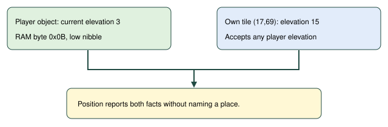

# Player elevation

> Markdown twin of [player-elevation-readout-v1.html](../player-elevation-readout-v1.html), generated from the HTML by `just explainer-twins`. The HTML is the source; edit it, not this file.

`player-elevation-readout-v1` adds your verified elevation to the existing Position line, even when no other level is visible.

## Same recorded position, one added fact

Native reparse of GLM run 0d5d, state 127085, raw RAM archive 21932. The source run remains unchanged; ON below is a candidate rerender.

### OFF

```
Position: X=17, Y=69, facing up
```

### ON

```
Position: X=17, Y=69, facing up, elevation 3, on a tile that accepts any elevation (15)
```

## Player and tile have separate elevations



The tile's acceptance rule says which elevations it accepts. It does not say every direction is walkable or that objects cannot block movement.

| Known own tile | Position suffix |
|---|---|
| 0 or 15 | Player elevation and the tile's accept-any-elevation rule |
| Any other elevation, or tile unavailable | Player elevation only |
| Player position unavailable | No invented elevation |

## Switch and evidence

Default OFF. Enabled in the seven current bundle definitions; their control arms stay OFF. The existing live-player-position-v1 switch still owns whether the Position line appears. OFF preserves previous readout bytes. No new tool, prompt advice, route choice or action.

The existing production reader supplies GameState.player_elevation. The formatter reads only the tile at the same coordinates, never a neighbouring tile or another sprite.

<details>
<summary>Verified game source and scope</summary>

pret/pokeemerald 731ad5bfd6e6f265508d0efcca0ba42f9dcf5881: include/global.fieldmap.h, ObjectEvent.currentElevation; src/event_object_movement.c, IsElevationMismatchAt. Tile elevations 0 and 15 accept any player elevation. Object collision uses a different rule and is outside this readout change.

Deterministic native regression and exact OFF comparison qualify factual delivery. This page does not claim better gameplay or authorize a run. No live run setting changes when this feature lands.

</details>
