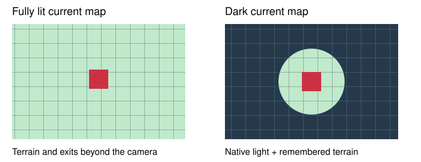

# Player map visibility V2

> Markdown twin of [player-map-visibility-v2.html](../player-map-visibility-v2.html), generated from the HTML by `just explainer-twins`. The HTML is the source; edit it, not this file.

See the whole current map when it is fully lit. Respect the game’s illumination when it is dark.

## Daylight and darkness

Illustration only; the light radius comes from the game, rather than the circle drawn here.

## What changes

| Place or state | V2 ON |
|---|---|
| Littleroot and fully lit rooms | Whole current map terrain, static exits and walking connections. |
| Dark gym or cave floor | Tiles inside the game’s current light region. Previously seen terrain stays remembered; hidden terrain is not refreshed. |
| Moving people | Only actors currently verified on screen and inside the light region. Remote NPC templates remain withheld. |
| Another floor or room | Its own map memory applies after entry. |
| Unknown lighting, hidden player, menus or transitions | No new terrain is disclosed until field visibility is verified. |

## The switch contract

`player-map-visibility-v2` is registered and defaults OFF. When OFF, observations retain the unrestricted baseline. The maintained recipe enabled V2 in both arms from 2026-11-01 until 2026-11-02 and turns it off in both arms since; generic next-run defaults stay OFF. Buggy V1 has been removed from active code and configuration. The already-running Qwen replacement retains its frozen build without V2; this change does not restart or modify it.

Navigation uses the same revealed terrain and listed static exits as the readout. Place names remain available to interpret dialogue; the global entrance graph stays withheld while V2 is active. This switch chooses no destination or action.

## Connected-map correction

Walking from a town onto a connected route keeps the same native player object. Its map ID records where it spawned, not necessarily the current map. Visibility verifies the native player, current coordinates, stationary position, rendered screen, free controls and illumination; it does not require that spawn ID to match. This corrects Route 101 terrain disappearing after leaving Littleroot, without revealing hidden terrain in dark maps or nonvisible actors.

## Game grounding and evidence

The existing native reader obtains `flashLevel` and illumination from Emerald. A verified value of zero exposes the whole current map in V2. Nonzero values retain the existing illumination projection, including progressive gym lighting. The source reference is pret/pokeemerald `731ad5bfd6e6f265508d0efcca0ba42f9dcf5881`, `field_screen_effect.c` (`sFlashLevelToRadius` and `SetFlashScanlineEffectWindowBoundaries`) and `overworld.c` (`SetFlashLevel`).

Projection, installed-observation and native-archive checks establish the visibility contract. Gameplay benefit requires a separate measured comparison.
