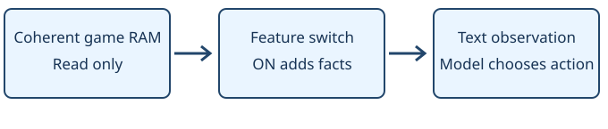

# Poison readout

> Markdown twin of [poison-readout-v1.html](../poison-readout-v1.html), generated from the HTML by `just explainer-twins`. The HTML is the source; edit it, not this file.

`poison-readout-v1` · Independent switch · Default OFF · Bundle ON

## What changes

The party status becomes readable independently of status-names-v1. While a living player-owned Pokémon is poisoned on the field, the readout quotes: “If you walk around with a poisoned POKéMON, it will lose HP until it faints.”

### OFF · existing observation

```
STATUS 8
```

### ON · same saved game state

```
STATUS PSN (poisoned)
```

## Game state to model observation



The diagram scrolls horizontally on small screens.

OFF preserves the existing observation. Neither switch changes the game or chooses an action.

## Game grounding and bounds

PetalburgCity_Mart_Text_TakeSomeAntidotesWithYou (data/maps/PetalburgCity_Mart/scripts.inc); GetAilmentFromStatus (src/party_menu.c); DoPoisonFieldEffect (src/field_poison.c). No ANTIDOTE, healing destination or route is introduced.

The warning is absent in battle, on other screens, for fainted Pokémon, or when player ownership is unknown.

Reference: pret/pokeemerald `731ad5bfd6e6f265508d0efcca0ba42f9dcf5881`; US Emerald SHA-1 `f3ae088181bf583e55daf962a92bb46f4f1d07b7`.

## Evidence and status

Before/after example is from saved GLM run 557c, turn 330, state seq 26833 and delivered frame seq 26834. Offline replay only; the current run was untouched. With both switches OFF, the full 10,523-character observation matches unchanged main byte for byte. State JSON is unchanged across all four combinations.

Separate pending experiments; no queue position or launch. Tests establish readout correctness, not better gameplay. Review and landing status are reported in the chat.
