# POKÉDEX OWN

> Markdown twin of [pokedex-own-v1.html](../pokedex-own-v1.html), generated from the HTML by `just explainer-twins`. The HTML is the source; edit it, not this file.

`pokedex-own-v1` · server readout switch · bundle-only, default off · Rustboro gym strategy report, training and catching sets (Operator, 2026-10-21: "both sets")

Once the POKéDEX is received, a line after the Party line gives the POKéDEX list's HOENN SEEN and OWN counts and the party size. In a wild battle, one more line per foe says whether that species is in the OWN list.

10 of 11 runs that reached the RUSTBORO CITY GYM fought wild WATER or GRASS POKéMON 36 times and threw no POKé BALL at them. The only two catches (1331's WURMPLE, fd95's POOCHYENA) answered MOM's line.

## What the model reads

ON

POKéDEX: SEEN 6 · OWN 1 (the POKéDEX list's HOENN counts) · party 1 of 6 Wild WURMPLE: not in your POKéDEX OWN list

OFF (today)

(no lines)

Actual output on run 1331's raw RAM at its wild WURMPLE battle (turn 497).

## How it is wired

*The switch travels from the run preset to one owner, which adds its text to the tool result. Nothing else changes.*

## Game grounding

pret/pokeemerald `include/global.h`: SaveBlock2 +0x18 struct Pokedex, owned\[52\] at +0x10, seen\[52\] at +0x44; SaveBlock1 seen1 +0x988, seen2 +0x3B24. `src/pokedex.c` GetSetPokedexFlag counts SEEN only when all three seen copies agree and OWN only when owned also agrees; GetHoennPokedexCount runs over the 202 Hoenn entries of sHoennToNationalOrder. ROM: sSpeciesToNationalPokedexNum 0x0831DC82, sHoennToNationalOrder 0x0831DFB8. The SEEN and OWN labels are drawn tiles on the POKéDEX list screen.

## Status

- Tests on recorded runs 1331, 97a0, fd95 and 6abf (see the worklog `docs/worklogs/active/2026-10-21_training-catching-switches.md`).
- Bundle arm of bundle-v-control, bundle-cook-1h, whole-map-cook-1h and whole-map-pair-2h: ON. Control arm and next-run default: OFF.
- Pending experiment `experiments/pokedex-own-v1.json`, not queued. No measured runs yet; nothing here claims the switch helps.
- Recorded check: run 1331 OWN 1 before its WURMPLE catch and 2 after; the wild WURMPLE battle reads 'not in your POKéDEX OWN list'.
