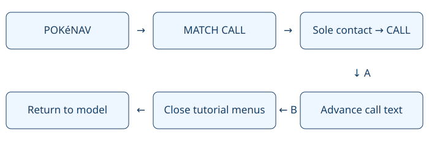

# PokéNav call auto-advance

> Markdown twin of [pokenav-call-auto-advance-v1.html](../pokenav-call-auto-advance-v1.html), generated from the HTML by `just explainer-twins`. The HTML is the source; edit it, not this file.

`pokenav-call-auto-advance-v1` — enabled in the current bundle by Operator on October 28, 2026; promoted to both arms on November 1, 2026 ("control should have that switch"). Registered and standalone defaults remain OFF. Existing runs keep their recorded settings.

## Why this switch exists

Qwen run 88ea spent 116 turns and about 22 minutes inside the forced tutorial. After its first call ended, 84 of the next 86 decisions repeated DOWN, DOWN, A, alternating between the contact list and CANCEL. These traces motivate the candidate; they do not measure its benefit.

## One verified input at a time

Each arrow checks the native owner, map, mode and selection again immediately before an ordinary button press. In the forced tutorial the game itself requires the call; outside it the model chooses contacts.

## Call text and safety bounds

The reader identifies the message-box text printer, including its waiting states while the root interface is busy. It presses A at verified text waits and at a finished call. Printing and transitions wait without inputs. Call text comes from the active message buffer, is labelled as such, and is retained in the tool result with the original result and the final observation.

Limits: 50 automatic presses, 90 seconds overall, 10 seconds continuously unready. If an input fails after submission, the receipt names the pending button as possibly executed and never retries it. Unknown ownership, map or recipient changes and unexpected menus stop automation. Ordinary call completion returns to contact selection without making another call.

| OFF | ON |
|---|---|
| Existing tools, prompt and readout; no automatic PokéNav inputs. | Native call printer readout, bounded tutorial/call handling, exact input receipt and call text. |

## Game grounding and evidence

pret/pokeemerald revision 731ad5bfd6e6f265508d0efcca0ba42f9dcf5881: RustboroCity_EventScript_MatchCallTutorial; HandleMainMenuInputTutorial; CB2_HandleMatchCallOptionsInput; CB2_HandleCallExitInput; DoMatchCallMessage; TextPrinter and RenderText. The scientist says: “Test it out. Please give our PRESIDENT a call.”

Uses ordinary inputs only. Automatic inputs and call text are recorded in the existing dialogue_auto_advance event and shown in Activity History and the raw-event inspector; no new timeline marks. Historical logs are unchanged. A future fixed-run comparison is required to measure benefit. No new gameplay run is authorized by this change.
