Harness switch · guidance · `presence-penalty-v1` · needs nothing · off by default

# Presence penalty 1.5

> Markdown twin of [presence-penalty-v1.html](../presence-penalty-v1.html), generated from the HTML by `just explainer-twins`. The HTML is the source; edit it, not this file.

With the switch on, every chat request the agent sends the model carries `presence_penalty: 1.5`. That is the value the Qwen3.6-35B-A3B model card recommends for thinking mode. The serving lane's own default is 0. Nothing the model reads changes: the prompt, tools and observations are the same. Only how the server picks tokens changes.

## 1. What a presence penalty does

Before picking each token, the server has a score (a logit) for every candidate. A presence penalty subtracts a flat amount from the score of any token that already appears in the generated text. It does not matter whether the token appeared once or ten times: the cut is the same.

A frequency penalty is different. It subtracts an amount for every time the token appeared, so the cut grows with the count. This switch sets only the presence penalty. It does not set a frequency penalty.

*Illustrative numbers, not recorded scores. With presence 1.5, "wait" and "so" both lose exactly 1.5 even though "wait" appeared four times as often. "go" has not appeared, so it keeps its score and now ranks first. A frequency penalty would cut "wait" by 2.0 and "so" by only 0.5.*

In llama.cpp, the "already appeared" check looks back over a recent window of tokens (its `penalty_last_n` setting), not necessarily the whole reply. This page did not record that window's value on the lane.

## 2. Why: the model card and the lane disagree

The Qwen3.6-35B-A3B model card lists recommended sampling for thinking mode on general tasks. The serving lane (llama-server, `/props` `default_generation_settings`) uses its own defaults. Every agent request today sends none of these fields, so the lane's defaults apply.

| Setting | Model card (thinking, general) | Lane default | This switch ON |
|---|---|---|---|
| `temperature` | 1.0 | 1.0 | unchanged |
| `top_p` | 0.95 | 0.95 | unchanged |
| `top_k` | 20 | 20 | unchanged |
| `presence_penalty` | **1.5** | **0.0** | **1.5** on every chat request |
| `min_p` | 0.0 | 0.05 | unchanged (differs, out of scope here) |
| `repetition_penalty` | 1.0 (off) | not checked for this page | unchanged |

The highlighted row is the gap this switch closes. `min_p` also differs (0.0 on the card, 0.05 on the lane), but this switch does not touch it. That would be a separate switch.

**Observation, not proof.** Cook run #2 shows repetition in the model's thinking. The reasoning at turns 889 and 890 is identical. During turns 445 to 716 there were about 270 consecutive near-identical "wait" thoughts. These are the kind of loops a presence penalty is meant to discourage. Nobody has measured whether 1.5 reduces them here.

The model card also notes that high presence penalty values may cause language mixing (the model drifting into another language). Watch for that in ON runs.

## 3. Wiring

The switch takes two paths. One adds the field to the request body. The other records it in `run_start` so a run can be audited later.

*ON path. The highlighted box is the only place the request changes: a payload hook merges `presence_penalty: 1.5` into the body pi-ai is about to send. The left path records the same value in `run_start`; the event schema gains an optional numeric `presence_penalty` under `sampling`.*

|  | OFF (default) | ON |
|---|---|---|
| `samplingExtras` | `{}` | `{ presence_penalty: 1.5 }` |
| Payload hook | none: `gatewayLoopConfig` adds `onPayload` only when extras exist | `onPayload` merges the extras |
| Request body | unchanged, no `presence_penalty`; lane default (0.0) applies | same bytes plus `presence_penalty: 1.5` |
| `run_start.sampling` | `{thinking_level, max_tokens}` as before | `{thinking_level, max_tokens, presence_penalty: 1.5}` |
| What the model reads | identical in both: prompt, tools and observations do not change |  |

Tests: `provider.test.ts` drives the real loop config through a fake gateway. OFF request bodies have no `presence_penalty` and the loop base has no hook. ON, every chat request carries 1.5 and is otherwise byte-equal to the OFF body. `presence-penalty.test.ts` covers the registry, presets, `samplingExtras`, `playSampling` and the `run_start` schema. Removing `samplingExtras(features)` from `playLoopBase` turns a test red.

## 4. Lane check

llama-server b10236 serving Qwen3.6-35B-A3B lists `presence_penalty` in `/props` `default_generation_settings`. A chat request with `presence_penalty: 1.5` returned HTTP 200. A `/completion` request with the same value echoed `generation_settings.presence_penalty = 1.5`. So the lane reads the field rather than ignoring it.

**Mistake.** Those two probe requests (about 04:08 AM New York time) reached the lane while the overnight control trial `runs/2026-10-16T03-50-01_qwen36-gpu1_687e` was live. Its turns 374 (7.6 s) and 382 (6.3 s) show outlier latencies. This was reported so the overnight thread can flag that trial. From now on, checks on this branch send no requests to either GPU lane while trials run.

## 5. Status

- Registered as `presence-penalty-v1` (guidance group, no dependencies). Default off in every preset.
- The operator wants it in the `bundle-v-control` bundle arm only. The readiness thread edits that bundle file; this branch does not.
- Gates green at the M3 commit: agent tests 1451 passed, coverage at or above 90 (`presence-penalty.ts` and `provider.ts` at 100%).
- Multi-model review: pending.
- Measured runs: none. There is no evidence yet that it helps or hurts.
