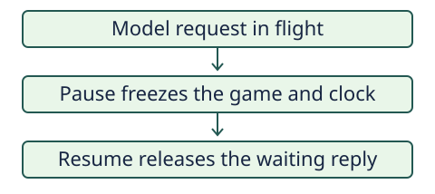

# Provider wait pause

> Markdown twin of [provider-wait-pause-v1.html](../provider-wait-pause-v1.html), generated from the HTML by `just explainer-twins`. The HTML is the source; edit it, not this file.

Default on in every lane. When the gateway pauses a run during a model request, PokéBench freezes the emulator and suspends the active wall clock.

## During a request

*Any tool calls in a reply that arrives during the hold wait for resume. Stop or abort ends the run while it waits.*

## What the clock counts

A 12-hour active budget with a 3-hour provider hold expires after 15 hours of elapsed time. The applied pause event records `during_call: true` and whether the emulator confirmed the freeze. The resume event records the paused duration.

With the switch off, a pause waits for the next safe boundary. A resume received before that boundary cancels the pending pause, so the hold counts toward the budget.
