Harness switch · guard · `pushback-loop-detection-v1` · no dependency · off by default · bug fix: ON in both arms

# Push-back loop detection

> Markdown twin of [pushback-loop-detection-v1.html](../pushback-loop-detection-v1.html), generated from the HTML by `just explainer-twins`. The HTML is the source; edit it, not this file.

Some game scripts stop the player and walk them back: the Littleroot twin before the player has a POKéMON, and PROF. BIRCH on Route 101 ("Wh-Where are you going?!"). The loop guard never saw a model walking into the same script again and again. With this switch on, a press or `navigate_to` that a script returns to the place it left counts as a push-back, and the third push-back by the same input raises a cycle warning and the supervisor briefing. Off: push-backs are not tracked.

## Why

| Run | Window | What happened | Loop guard (today) |
|---|---|---|---|
| `sh02` (2026-10-16) | T141–T171, seq 2934–3615 | UP at Littleroot (11,2) walks to (11,1); the twin's message opens, auto-advance pages it, the script walks the player back to (11,2). 15 round trips. | silent; only `milestone_drought` at T171 |
| `sh02` | T263–T307, seq 5927–7271 | The same batch `LEFT,LEFT,LEFT,UP,UP,UP` 45 times on Route 101: LEFT steps onto (6,15), BIRCH's script returns the player to (7,15). | silent; only `milestone_drought` at T307 |

## Why the guard missed it

Confirmed by replaying the recorded events through the production `LoopDetector` with the run's own switches.

| Cause | Evidence |
|---|---|
| Auto-advance's B presses are recorded as presses of the same tool call. Each one replaced the call's before state and, with interaction loop detection on, its action. A push-back call read as *B pressed in a message at (6,15), ended free at (7,15)*. | Birch seq 5945: `button_press ["B"]`, before state 5944 at (6,15), message open. Every push-back call has a different before and after, so the "same input, same state" check never counts. |
| A script-locked result with no message has no fingerprint, and a missing fingerprint clears the cycle history. | Twin T143: result at (11,1), field locked, script running (mode 2, status 0), no message yet. The history is cleared every other call. |
| The restarted-conversation check needs the message open in the result; auto-advance has already closed it. | Every push-back result is free with no dialogue. |

## What counts as a push-back



*Coordinates and calls are from the recorded sh02 events. The anchor is the last settled result (field controls free, no message).*

| Rule | Value |
|---|---|
| Settled state | fingerprint known, `field_controls_locked` false, no dialogue, no message |
| Push-back | a press or `navigate_to` result settled and equal to the anchor, after the player left the anchor tile **and** an open message or the game's script context running held the controls (a door or stairs animation, a menu or a lock of unknown origin does not count). Left means seen on another tile, or, while a script holds the controls, facing away from the direction just pressed: no input does that, so the script stepped the player back between snapshots (54a7 T247, OldaleTown_EventScript_BlockedPath) |
| Way out | the trip's first button, or the map a `navigate_to` targeted; never auto-advance's B. Loops with irregular periods (LEFT then LEFT,LEFT; DOWN,A,A then DOWN,DOWN,A,A; navigate_to to (10,0) then (11,0)) still count as one |
| Warning | the same way out 3 times (`cycleRepeats`) among the last 12 push-backs → `cycle` warning, then the supervisor briefing |
| Reset and recovery | a settled result elsewhere moves the anchor; more than 8 game calls (observes included) with no settled result, or an errored press, drop it. A push-back episode recovers only on a map or tile not among the last 16 results, or a story milestone; a new state on a known tile (one START opening the menu) does not end it or clear the count |
| Not push-backs | reading the same conversation in place, walking back and forth with free controls, bumping a wall, a door bounce, attempts between which money, party, story or items changed |

## What the model reads

The recorded warning, and the note the model gets when the supervisor is off:

```
LOOP GUARD (cycle): A game script keeps returning the player to the same place after the same input: each attempt ends back where it started, so repeating it will not get past the script. Read what the script's dialogue says, then choose a different target or approach using observed evidence. Recovery is bounded; objective wording and new evidence IDs alone do not establish progress.
```

With `loop-guard-supervisor-v1` on, as in both arms, the next model call gets the supervisor briefing for a cycle ("You keep repeating the same short cycle of actions…"), re-posted every 6 calls while the loop lasts. The briefing text is unchanged by this switch.

## Replay receipts

| Window | OFF | ON |
|---|---|---|
| sh02 twin | no notice | warning + supervisor T146 seq 3062 (evidence 2973, 3062: the push-backs at T142 and T146); re-brief T152, T158, T164, T170; recovered T173 seq 3693 when `navigate_to` reached (12,9) |
| sh02 Birch | no notice | warning + supervisor T265 seq 6011 (evidence 5951, 6011); re-brief every 6 calls to T307; recovered T308 seq 7300 at a new tile ((6,13), the starter scene) |

A replay sweep of the 60 most recent runs adds a push-back warning in two more: `939e` T341 (the twin, without auto-advance: UP then A three or four times) and `9d86` T470 (BIRCH: LEFT, A, A three times). Both were checked by hand and are real push-back loops. This is a replay of recorded events; it does not say what the model would have done next.

## Cook audit acceptance cases

From `runs/reports/2026-10-16-cook-harness-audit/`, replayed from schema-valid recorded events through `attachLoopGuard`.

| Case | Before | With the switch |
|---|---|---|
| 54a7 T80–T114, Littleroot twin; navigate_to targets vary | no loop guard | warning T88 seq 1927; recovered T115 |
| 54a7 T247–T343, Oldale BlockedPath; step-back never in a snapshot | no loop guard | warning T254 seq 6212 |
| 1623 T85–T304, Mom in the 1F hall (DOWN,A,A / DOWN,DOWN,A,A) | warning T142, START "recovered" it at T145, then 147 turns unguarded | warning T96; START does not recover; supervisor briefings at most 12 turns apart; recovered T304 on the new map upstairs |
| sh02 T1068–T1086, Oldale Maniac | no loop guard | warning T1075 seq 18360 |

A sweep of the 70 most recent runs: every added warning that was checked by hand (12 runs, among them 1623 T934, 54a7 T402, e588 T498, show T115, 3f21 T146, 939e T276, d116 T617, ab34 T358, 4fe9 T102/T377, 26e0 T146) is the twin, Birch, Maniac or BlockedPath push-back.

## Wiring

Preset or switchboard → `FeatureSet["pushback-loop-detection-v1"]` → `attachLoopGuard(…, pushback)` in `live.ts` and `decision-probe.ts` → `LoopDetector`'s push-back tracker. The `loop_guard` event, timeline row and replay are the existing ones (kind `cycle`).

## Status

Tests in `packages/agent/src/pushback-loop-detection.test.ts` (both recorded windows ON and OFF, synthetic push-backs and negatives) and a `live.ts` factory test. Ships with [push-back press results](pushback-press-result-v1.md) and [battle observation loop](battle-observation-loop-v1.md). No measured runs.
