Harness switch · guidance · `pushback-press-result-v1` · no dependency · off by default · bug fix: ON in both arms

# Push-back press results

> Markdown twin of [pushback-press-result-v1.html](../pushback-press-result-v1.html), generated from the HTML by `just explainer-twins`. The HTML is the source; edit it, not this file.

Scripts move the player while dialogue auto-advance pages their message, between two snapshots of one press, and between one call and the next. The results only described the model's own input, so a push-back read as "no net movement", "turned left -&gt; right" or only as a restarted conversation, and navigate_to said to call it again. With this switch on, press and navigate_to results say that a script moved the player, with the tiles. Off: today's text.

## Three snapshots, not two

*Birch on Route 101, sh02 T263. Tiles from the recorded states 5928, 5942 and 5950.*

## Before and after

| Case | OFF (today) | ON |
|---|---|---|
| Birch, first time | `moved (7,15) -> (6,15)` | `moved (7,15) -> (6,15); this call: your press moved you (7,15) -> (6,15), then a script moved you back (6,15) -> (7,15) while the dialogue advanced; you are back where this press began` |
| Birch, again (sh02 T263+) | `conversation restarted: this text was already shown (2nd time)` | `conversation restarted: this text was already shown (2nd time); this call: your press moved you (7,15) -> (6,15), then a script moved you back (6,15) -> (7,15) while the dialogue advanced; you are back where this press began` |
| Twin, message already open (sh02 T146) | `locked (field controls locked in a snapshot; no net movement)` | `locked (field controls locked in a snapshot; no movement by the press); this call: your press did not move you, then a script moved you (11,1) -> (11,2) while the dialogue advanced` |

The OFF texts are the ones recorded in sh02, reproduced by the tests with a fake game. Tiles appear only when the player position is shown (`live-player-position-v1`); a script that moves the player to another map names both places. When the script did not move the player, the line is unchanged. Nothing is shortened.

## Cook audit acceptance cases

Recorded snapshots from `runs/reports/2026-10-16-cook-harness-audit/`; the OFF column is the text the model was given, reproduced by the tests.

| Case | OFF | ON |
|---|---|---|
| 54a7 T82 seq 1790 (twin, auto-advance) | `locked (field controls locked in a snapshot; no net movement)` | `locked (field controls locked in a snapshot; no movement by the press); this call: your press did not move you, then a script moved you (10,1) -> (10,2) while the dialogue advanced` |
| 54a7 T92 seq 2014 (navigate_to) | `…; after auto-advance: the conversation closed and field controls are free; call navigate_to again; 0 ordinary button attempts.` | `…; after auto-advance: the conversation closed and field controls are free; a script moved you (10,1) -> (10,2) while the dialogue advanced; 0 ordinary button attempts.` |
| 54a7 T247 seq 6039 (BlockedPath, one press, no message) | `turned left -> right; no net movement` | `a script took over during your press: you pressed LEFT and now face right on the same tile (1,10), with field controls held by a running script; your press cannot turn you right, so the script turned you or stepped you back between snapshots` |
| sh02 T1072 (Maniac trigger) | `moved (1,10) -> (0,10)` | `moved (1,10) -> (0,10); then a script took over: field controls are held by a running script (no message yet), which may move you` |
| sh02 T1073 (walked back between calls) | `locked (field controls locked in a snapshot; no net movement)` | `a script moved you (0,10) -> (1,10) after your last result, before this press; this press: locked (field controls locked in a snapshot; no net movement)` |
| sh02 T1080 (no dialogue at all) | `locked (field controls locked in a snapshot; no net movement)` | `a script took over during your press: you pressed LEFT and now face right on the same tile (1,10), …` |
| sh02 T264 (LEFT×3 UP×3 into Birch's message) | event: sent all six, dropped none | event: sent LEFT, dropped LEFT, LEFT, UP, UP, UP; the result says `5 inputs of your batch had no effect (counted as dropped): the message opened during the batch and held field controls while they were pressed: …` |

"Took over" needs free controls when the press began, the same tile, a message or running script holding the controls after it, and the player facing away from the direction pressed. The walk-batch split is claimed only when exactly one prefix of the batch, one tile per input, explains where the player stood when the message opened; a bump, a turn in place, a non-direction input or two fitting prefixes leave every input as sent. A move between results is called a script's only when the last result itself showed a script holding the controls.

## Wiring

`FeatureSet["pushback-press-result-v1"]` → `toolSwitches().pushback` → `withDialogueAutoAdvance`, which applies `pushbackPressResult` (press-result.ts) to the press result when auto-advance ran. `decision-probe` keeps auto-advanced results as recorded and refuses to flip this switch on them, as for the other switches that shape that text.

## Status

Tests in `packages/agent/src/pushback-press-result.test.ts` (fake game for both scripts, wording rules, registry and tool-switch wiring). Ships with [push-back loop detection](pushback-loop-detection-v1.md). No measured runs.
