# Random starter pick

> Markdown twin of [random-starter-v1.html](../random-starter-v1.html), generated from the HTML by `just explainer-twins`. The HTML is the source; edit it, not this file.

`random-starter-v1` · guard · default off in every arm · a data-collection switch, not a harness improvement.

The operator, 2026-10-22: most long runs chose Torchic, so there is little long-play data on the other two starters. With this switch on, the harness picks Treecko or Mudkip with a fair coin once per run, presses its way to that starter in Professor Birch's bag, confirms it, and hands the game back. Nothing else about the harness changes.

## What happens at the bag

*The pick replaces only the model's press that lands on the open bag. Off, or away from the bag, a press behaves exactly as it did before.*

## Game grounding

| Fact | Source |
|---|---|
| Bag order TREECKO, TORCHIC, MUDKIP; cursor starts on TORCHIC; LEFT decrements, RIGHT increments | pret `starter_choose.c` Task_HandleStarterChooseInput; `menus.py` read_starter_ui |
| A opens "Do you choose this POKéMON?" with YES highlighted; YES takes it; B declines back to the bag | Task_HandleConfirmStarterInput; readout phase `starter_confirmation`, value = the starter |
| Done when the bag closes after the harness pressed A on YES (the rival battle follows) | party and battle read from RAM afterwards, as usual |

## What is recorded

- Each harness press is an ordinary `button_press` event under the model's tool call id, so the presses lane shows them.
- The pick is in that call's `tool_result` text: `Starter pick: the harness chose MUDKIP at random (TREECKO or MUDKIP, 50/50) and confirmed it.`
- The party in the following state events shows the species, and `STARTER_CHOSEN` fires as before.

## Bounds and failure

If the bag stays in a transition for 10 s, shows a diagnostic, or the starter is not taken within 12 presses, the result says "the harness tried to choose … but stopped: &lt;reason&gt;". The model's buttons are still not sent; its next press at the bag tries again with the same pick.

## Status

Default off in presets, the viewer's next-run defaults and every fixed experiment. Used only by the one-arm `random-starter-2h` data run (incumbent bundle arm plus this switch). Never part of a measured comparison.
