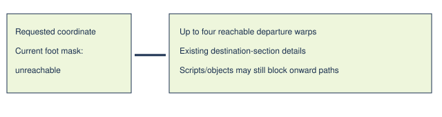

# Reachable departure section alternatives

> Markdown twin of [reachable-section-alternatives-v1.html](../reachable-section-alternatives-v1.html), generated from the HTML by `just explainer-twins`. The HTML is the source; edit it, not this file.

E9 repeatedly tried an unreachable edge of ROUTE 104. Existing destination-section facts already describe the WOODS exits that return to different terrain sections. This treatment brings those facts into the failed navigation result.

## Facts at the failed decision

No route to the requested coordinate is established. The model chooses whether to inspect a departure. No movement is added.

## Exact contract

| OFF | ON |
|---|---|
| Unchanged navigation refusal. | When the live foot mask says the goal is unreachable, append existing exit_sections facts for up to four currently foot-reachable departure warps, sorted by y then x. |

Unknown foot masks, missing destination sections, unknown landings, blocked departures and matching coordinate scripts on departure tiles withhold those alternatives. Each included departure has a live foot classification and an adjacent reachable tile. The full original detail retains the warning that temporary objects and scripts may block the terrain path.

## Source and limits

env/pokebench_env/map_sections.py builds directed terrain sections from native map warps, landing coordinates and existing field-move gates. Its delivered details distinguish a return to the same or a different terrain section. This feature repeats those already-delivered strings; it does not traverse another map graph or supply an unseen story destination. Production regression replays fixture exit-sections-b300.json, observation 18834.

Current navigation factory → default-OFF switch → failed local path → live reachability filter → delivered section alternatives → returned observation. Gameplay safety and temporary gates remain the existing executors' responsibility.

## Status

Default OFF; prepared bundle ON/control OFF, requires exit-labels-v3. Independent pending unapproved experiment. Synthetic and recorded-fixture correctness tests establish content/qualification; they do not establish navigation benefit. No probes, measured runs, GPU changes or service restarts.
