Harness switch · observation · `readout-rules-in-prompt-v1` · off by default

# Readout rules in the prompt

> Markdown twin of [readout-rules-in-prompt-v1.html](../readout-rules-in-prompt-v1.html), generated from the HTML by `just explainer-twins`. The HTML is the source; edit it, not this file.

Every overworld readout repeated the same four blocks of text under its map: the symbol legend, the terrain rule, the warp-destination note and the trigger-elevation rule. They never change during a run. With this switch on, the server stops printing them, the system prompt states them once, and a single line under the map points there. Nothing else in the readout changes or moves.

## Why it exists

In the showcase arm of bundle-v-control (run `2026-10-16T00-34-26_qwen36-gpu1_show`), all 451 overworld tool results carried the four blocks, about 890 characters each, 16% of a median 5,509-character result. The legend line was the same string in all 2,811 places it appeared. The operator proposed moving only this fixed text, leaving script-trigger lists, interaction candidates and the readout's order alone.

## The real readout, off and on

```
Local map from live memory; top-left (-2,-5), north is up:
      -2  -1   0   1   2   3   4   5   6   7   8   9  10  11  12
  -5   ?   ?   ?   ?   ?   ?   ?   ?   ?   ?   ?   ?   ?   ?   ?
  -4   ?   ?   ?   ?   ?   ?   ?   ?   ?   ?   ?   ?   ?   ?   ?
  -3   ?   ?   ?   ?   ?   ?   ?   ?   ?   ?   ?   ?   ?   ?   ?
  -2   ?   ?   ?   ?   ?   ?   ?   ?   ?   ?   ?   ?   ?   ?   ?
  -1   ?   ?   ?   ?   ?   ?   ?   ?   ?   ?   ?   ?   ?   ?   ?
   0   ?   ?   #   #   #   #   #   #   #   #   #   ?   ?   ?   ?
   1   ?   ?   #   #   #   #   #   #   #   W   #   ?   ?   ?   ?
   2   ?   ?   .   .   .   .   .   @   .   N   .   ?   ?   ?   ?
   3   ?   ?   .   .   .   .   .   .   .   .   .   ?   ?   ?   ?
   4   ?   ?   .   +   .   .   .   .   .   .   .   ?   ?   ?   ?
   5   ?   ?   .   #   .   .   .   .   .   .   .   ?   ?   ?   ?
   6   ?   ?   .   .   .   .   .   .   .   .   .   ?   ?   ?   ?
   7   ?   ?   .   .   .   .   .   .   .   .   .   ?   ?   ?   ?
   8   ?   ?   ?   ?   ?   ?   ?   ?   ?   ?   ?   ?   ?   ?   ?
   9   ?   ?   ?   ?   ?   ?   ?   ?   ?   ?   ?   ?   ?   ?   ?
@ player; N live object; W warp location (see activation below); # collision; g grass; ~ water; v ^ < > ledge: a one-way hop in the arrow's direction (move into it that way to jump over it, landing 2 tiles on); impassable from any other side; + edge walls: walkable, but movement across a walled side is refused in both directions (sides listed under Edge walls); . clear terrain (may have script triggers); ? outside current map.
Terrain rules, elevation and objects can still block movement.
Edge walls: (1,4) north+south
Live objects: id 14 at (7,2)
Warps: (7,1) -> LITTLEROOT TOWN BRENDANS HOUSE 1F (map 1/0) [step onto tile]
Warp destinations are the map you arrive on: its name when the game's map table has one, then its group/number ID in parentheses; not warp indexes. Activation also requires matching elevation and available field controls; W alone does not guarantee a transition. After a transition, check the new map and position.
Metatile behaviors present: 0x00, 0x60, 0x85, 0x86, 0xB5, 0xC0, 0xC3
Field objects (ids are map-local, not globally unique; sprite kinds are not personal names):
- map 1/1 object 14: sprite MOM (graphics 215) at (7,2)
Nearby script-trigger tiles (a clear terrain tile can still run a script):
Trigger elevation must also match the player on entry (0 matches any elevation).
Field-message text: unavailable; do not infer that the dialogue box is closed.
Field-message phase: unavailable; do not infer a cutscene or an input-ready dialogue.
```

*OFF, real ROM: `pokebench_env.serve` from `rival-push-checkpoint/CLOCK_SET.state` (Brendan's house 2F), switches of the showcase arm. Struck lines are the ones the switch removes. Whole readout: 4,040 characters.*

```
Local map from live memory; top-left (-2,-5), north is up:
      -2  -1   0   1   2   3   4   5   6   7   8   9  10  11  12
  -5   ?   ?   ?   ?   ?   ?   ?   ?   ?   ?   ?   ?   ?   ?   ?
  -4   ?   ?   ?   ?   ?   ?   ?   ?   ?   ?   ?   ?   ?   ?   ?
  -3   ?   ?   ?   ?   ?   ?   ?   ?   ?   ?   ?   ?   ?   ?   ?
  -2   ?   ?   ?   ?   ?   ?   ?   ?   ?   ?   ?   ?   ?   ?   ?
  -1   ?   ?   ?   ?   ?   ?   ?   ?   ?   ?   ?   ?   ?   ?   ?
   0   ?   ?   #   #   #   #   #   #   #   #   #   ?   ?   ?   ?
   1   ?   ?   #   #   #   #   #   #   #   W   #   ?   ?   ?   ?
   2   ?   ?   .   .   .   .   .   @   .   N   .   ?   ?   ?   ?
   3   ?   ?   .   .   .   .   .   .   .   .   .   ?   ?   ?   ?
   4   ?   ?   .   +   .   .   .   .   .   .   .   ?   ?   ?   ?
   5   ?   ?   .   #   .   .   .   .   .   .   .   ?   ?   ?   ?
   6   ?   ?   .   .   .   .   .   .   .   .   .   ?   ?   ?   ?
   7   ?   ?   .   .   .   .   .   .   .   .   .   ?   ?   ?   ?
   8   ?   ?   ?   ?   ?   ?   ?   ?   ?   ?   ?   ?   ?   ?   ?
   9   ?   ?   ?   ?   ?   ?   ?   ?   ?   ?   ?   ?   ?   ?   ?
Map symbols and rules: see the system prompt.
Edge walls: (1,4) north+south
Live objects: id 14 at (7,2)
Warps: (7,1) -> LITTLEROOT TOWN BRENDANS HOUSE 1F (map 1/0) [step onto tile]
Metatile behaviors present: 0x00, 0x60, 0x85, 0x86, 0xB5, 0xC0, 0xC3
Field objects (ids are map-local, not globally unique; sprite kinds are not personal names):
- map 1/1 object 14: sprite MOM (graphics 215) at (7,2)
Nearby script-trigger tiles (a clear terrain tile can still run a script):
Field-message text: unavailable; do not infer that the dialogue box is closed.
Field-message phase: unavailable; do not infer a cutscene or an input-ready dialogue.
```

*ON, same save and switches: 3,196 characters (−844, −20.9%). The legend and terrain lines became the pointer; the warp note and trigger-elevation lines are gone. Edge walls, Live objects, Warps (with each warp's activation), the trigger list header and the field-message lines are unchanged.*

## What the system prompt says instead

```
Map symbols and rules (the readout's map and lists use these every turn; the readout does not repeat them):
@ player; N live object; W warp location (each warp's activation is listed in the readout's Warps line); # collision; g grass; ~ water; v ^ < > ledge: a one-way hop in the arrow's direction (move into it that way to jump over it, landing 2 tiles on); impassable from any other side; + edge walls: walkable, but movement across a walled side is refused in both directions (sides listed in the readout's Edge walls line); . clear terrain (may have script triggers); ? outside current map.
Terrain rules, elevation and objects can still block movement.
Warp destinations are the map you arrive on: its name when the game's map table has one, then its group/number ID in parentheses; not warp indexes. Activation also requires matching elevation and available field controls; W alone does not guarantee a transition. After a transition, check the new map and position.
Trigger elevation must also match the player on entry (0 matches any elevation).
```

*The section for the showcase arm's switches, added once at the end of the play system prompt (OFF 7,886 characters, ON 8,941). Two parentheticals differ from the readout's legend so the prompt stays true: nothing is "below" in a system prompt, so the legend names the readout's Warps and Edge walls lines instead.*

## One owner for both sides



*Both paths start from the same FeatureSet and the same off set. The highlighted module is the only place the text and the choice of variant live. The agent cannot import Python, so `just map-rules` writes every switch combination into a generated table; a pytest fails when that file is stale. A server endpoint was rejected: the prompt is built and recorded before the game server boots, and `probe-decision` rebuilds prompts offline.*

## What each switch changes in the section

| Switch | When off, the section… |
|---|---|
| `live-map-v1` | has no legend, terrain rule or warp note (only the trigger rule, if that switch is on) |
| `warp-activation-guidance-v1` | says `W warp;` and has no warp note |
| `ledge-hops-v1` | does not describe `v ^ < >` |
| `one-way-tiles-v1` | does not describe `+` |
| `full-map-navigation-v1` | describes `? outside current map` (the local map draws it; the whole map never does) |
| `named-warp-destinations-v1` | uses the plain note: map group/number IDs, not warp indexes |
| `coordinate-script-conditions-v1` | has no trigger-elevation rule |

With both the live map and script conditions off there is nothing to state, and the prompt is unchanged.

## Two cases that stay in the readout

- **Counters.** The `=` legend is printed only on a map that draws a counter (with `counter-talk-v1`), so it is not constant within a run. ON, such a map keeps it as its own line right under the pointer: `= counter: you cannot walk onto it, but you can talk to someone standing behind it by facing the counter and pressing A.` The prompt never describes `=`.
- **Whole-map fallback.** With whole-map navigation on, a readout that falls back to the local map (whole map unreadable) draws `?`, which the prompt does not describe. That readout keeps its full legend and rules.

State-only decisions have no play system prompt to carry the section, so `state-only-decisions-v1` refuses this switch.

## Measured size

| Measure | Off | On | Change |
|---|---|---|---|
| Real ROM readout, CLOCK_SET save | 4,040 | 3,196 | −844 (−20.9%) |
| Showcase run, 451 overworld results, median (projected by removing the same lines) | 5,509 | 4,665 | −844 (15.2% of those results) |
| Play system prompt, showcase switches | 7,886 | 8,941 | +1,055 once |

Characters, not tokens. The prompt grows once per run; each overworld result shrinks every turn.

## Status

- OFF is byte-identical to 35 readouts rendered before the change (5 test memories × 7 switch sets) and the OFF prompt is unchanged.
- Gates: tests, lint (known worktree mGBA stub only), build, coverage ≥ 90% both stacks, vendor check.
- Pending experiment `experiments/readout-rules-in-prompt.json`. No measured runs yet: whether the model reads the map as well with the rules in the prompt is the open question.
