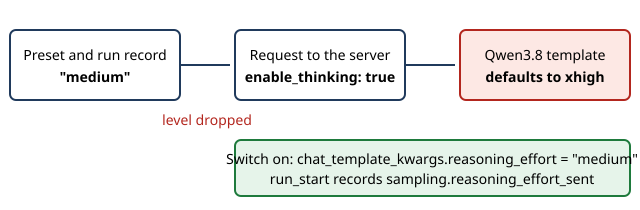

# Send the reasoning effort

> Markdown twin of [reasoning-effort-request-v1.html](../reasoning-effort-request-v1.html), generated from the HTML by `just explainer-twins`. The HTML is the source; edit it, not this file.

`reasoning-effort-request-v1` is a correctness fix, on by default. Every run recorded a thinking level of "medium", but no request ever carried it. The served chat template then chose its own default.

## What went wrong

## The proof

Run f604's first request, sent to vLLM's tokenizer on the real server:

| Effort | Prompt tokens | Instruction in the system prompt |
|---|---|---|
| As the harness sent it | 9,181 | xhigh: think carefully, validate key assumptions, consider alternatives |
| Recorded by f604, turn 1 | 9,181 | Same number, so this is what the run received |
| medium in chat_template_kwargs | 9,143 | None |
| low in chat_template_kwargs | 9,169 | Keep your thinking brief |
| medium as a top-level field | 9,181 | No effect on the tokenizer, so it is not used |

## What each lane ran at before this fix

| Lane | Runs | Effort | How we know |
|---|---|---|---|
| Qwen3.8-27B (vLLM) | 8 | xhigh | Measured on 4 runs, code path on 3, 1 has no turn |
| Qwen3.8 Flash Next (llama.cpp) | 26 | xhigh | Its template |
| GLM-5.3 Flash (llama.cpp) | 21 | Max | Its template; accepts only low and high |
| Qwen3.6 and think-\* lanes | about 645 | None | Template has no effort setting |
| DeepSeek via OrcaRouter | 16 | Unknown | Provider default |

## Old recordings

They are never edited. A run_start with no `reasoning_effort_sent` sent no effort, so the viewer shows "thinking on" for it and names what the lane ran at, from `served-effort.ts`.

## Reading results across the change

Earlier 27B and Flash results are valid xhigh results. They are not comparable with later runs at medium: the two differ in effort as well as in anything else that changed. Pinned builds keep their old behavior, so a run on an older pin still runs at the template default.

## Off

Requests carry only enable_thinking and preserve_thinking, and the server's default applies. run_start still records `reasoning_effort_sent: null`.
