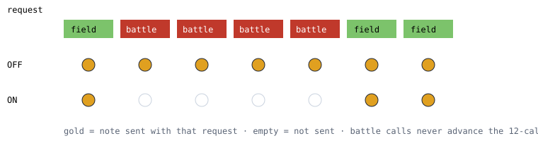

# Recovery note off the battle screen

> Markdown twin of [recovery-note-field-only-v1.html](../recovery-note-field-only-v1.html), generated from the HTML by `just explainer-twins`. The HTML is the source; edit it, not this file.

`recovery-note-field-only-v1` · guard · default OFF · needs `navigation-recovery-v1`

## What it fixes

`navigation-recovery-v1` sends its open note (`NAVIGATION RECOVERY: The repeated map cycle remains unresolved…`) with every model request until the episode resolves. Battle calls do not count toward its 12-call budget, so when a battle starts while a note is open, the note rides on every battle turn.

Run `2026-10-24T19-37-24_glm53-mac_6bbd` opened one on the overworld at turn 811. On battle turns 818 to 823 against ISAAC, the model wrote that the note was "boilerplate" that "fires mid-battle".

With the switch ON, battle requests carry no note. The episode stays open, and the same text comes back on the next field request.

## Requests over one battle

*Illustrative sequence. The episode itself does not change: it opens, resolves and briefs exactly as before. Only which requests carry its text changes.*

## Rules

- "In battle" is the latest recorded state's `in_battle`.
- A briefing that falls due is not marked as delivered on a battle request, so it is still shown after the battle.
- Nothing else in the loop guard changes. Other notes keep their own battle rules.

## Wiring

`FeatureSet["recovery-note-field-only-v1"]` → `attachLoopGuard` → `LoopDetector` → `LoopCoordinator` option `recoveryFieldOnly` → `NavigationRecovery.context()`, which returns nothing while the latest state is a battle.

## Status

- Tests: `packages/agent/src/recovery-note-field-only.test.ts` (OFF parity, ON suppression and return, briefing survives a battle, production loop guard honors the switch).
- Default OFF. `navigation-recovery-v1` itself is off in both arms of the current recipe, so this has no effect until that guard is turned back on.
- Not measured. No runs were started for this change.
