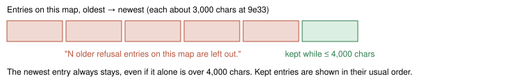

# Bounded refusal history (refusal-ledger-bound-v1)

> Markdown twin of [refusal-ledger-bound-v1.html](../refusal-ledger-bound-v1.html), generated from the HTML by `just explainer-twins`. The HTML is the source; edit it, not this file.

Default off. It needs refusal-ledger-v1. That switch adds "Navigation refusal history" to the belief ledger message: one entry for each target on the current map that navigation refused. This switch keeps whole entries within a budget. A quoted navigation result is never cut.

## Why

Each entry quotes the whole latest navigation result for its target. Water and wall refusals list the map's departure alternatives, so one entry is about 3,000 chars. Qwen run 9e33 at turn 2417 sent 10 such entries on ROUTE 104: 24,803 chars in one message, every turn. An entry's "at turns …" list also grows by one with every repeat of the same refusal.

## Rule



*Whole entries are kept from the newest back. The count line goes under the unchanged header.*

A repeated refusal keeps its full count and lists only its latest 10 turns:

```
- Target (20,60) in ROUTE104: 40 times navigation returned this reason, at turns 31, 32, 33, 34, 35, 36, 37, 38, 39, 40 (and 30 earlier turns). Latest result: "…"
```

The header, the recorded evidence and the recorded entry count are unchanged. OFF is byte-identical to today. ON is also byte-identical when nothing is over a bound.

## Recorded ledgers replayed

Each run's events were replayed into the ledger. With the switch off, every recorded refusal history in the run matches byte for byte.

| Run | Ledgers checked (all match OFF) | Largest recorded | Same turn ON | Largest ON in the run |
|---|---|---|---|---|
| Qwen 9e33 (T2417) | 1,284 | 24,803 | 3,212 | 4,723 |
| Qwen a702 (T852) | 408 | 10,310 | 2,664 | 3,440 |
| Qwen 88ea (T843) | 830 | 15,065 | 3,231 | 3,509 |

Chars, header included. 88ea is the live run; its events were only read.

## Companion switch: disproved-beliefs-bound-v1

The same belief-ledger message has a second part from disproved-beliefs-v1: "Things the game has contradicted". It lists each time a script pushed the player back, and each time the model placed a story character on a map whose readout says they are not there. Each entry quotes whole pages. Entries stay until a story flag changes or the game shows otherwise, and an entry's turn list grows with every repeat.

disproved-beliefs-bound-v1 (default off, needs disproved-beliefs-v1) applies the same rule to that part. Whole entries are kept within 4,000 chars, starting from the most recently seen, so an entry the model hit again just now stays even if it was created early, under "N older entries are left out.". A repeated entry lists its latest 10 turns with "(and N earlier turns)". Quoted pages are never cut. It is its own switch because it is separate code, so each part can be A/B tested on its own. That part never appeared in the four large runs checked (9e33, a702, 88ea, 429f). The tests replay run sh02's recorded turn-146 push-back (TWIN, LITTLEROOT TOWN), shifted one tile per entry, with long pages so that six entries cross the 4,000-char budget; one test repeats the first entry last to check that it is kept.

## Status

- Not landed on main, so not in any run yet.
- Budgets count code points (as the instruction-memory cap does). Focused tests pass: 7 refusal-bound and 8 contradiction-bound tests, including the production context path, and 73 with the existing refusal-ledger and disproved-beliefs tests (receipt: `runs/analysis/bounded-input-20261028/replays/refusal-ledger-bound-v1.focused.txt`).
- Activation is committed on the branch: `experiments/feature-configs/current.json` lists the switch in the bundle arm's `switches` (ON) and sets it false in the shared base (control OFF), per the operator 2026-10-28 ("they all need to be on in the bundle"). It takes effect only after landing and a new launch.
- Review and gates: three-lane review in progress; full gate on the frozen head under the relayed CPU grant. No measured runs yet.
