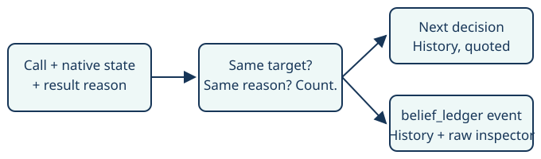

# Navigation refusal history

> Markdown twin of [refusal-ledger-v1.html](../refusal-ledger-v1.html), generated from the HTML by `just explainer-twins`. The HTML is the source; edit it, not this file.

`refusal-ledger-v1` · default OFF · needs `disproved-beliefs-v1` · unmeasured candidate

## The gap

Qwen repeatedly asked for the same destination after the harness returned a route refusal. The existing disproved-beliefs ledger retained script push-backs and character-absence claims, but omitted those navigation refusals.

This switch retains actual results. It does not choose the next destination, block another attempt, send input or end a run.

## What reaches the next decision



*One completed call counts once. Supervisor notices never become new attempts or authoritative advice.*

## OFF and ON

| OFF | ON |
|---|---|
| Existing disproved-beliefs text, events, prompts and tools remain byte-identical. | The same delivery appends navigation refusal history when an eligible entry exists. |

Tool names, arguments, descriptions, system prompt and event schema do not change. The existing `belief_ledger` event owns delivery evidence and Activity History. Nothing is added to the timeline.

## A recorded refusal

Source: `2026-10-22T08-11-26_qwen36-gpu1_2aca`, turn 559, result seq 20519; target (14,5), map 24/11. Whole delivered navigation line:

```
Navigation: every route navigate_to sees to (14,5) crosses a script-trigger tile whose condition matches now; the first one on the route it would take without avoiding them is (26,23) (variable 0x4098=0, needs 0); stepping on such a tile runs a script that can stop you or send you back, so navigate_to does not walk across one; target (26,23) itself to step on it on purpose; 0 bounded movement actions.
```

The candidate labels this **recorded harness history**, not current reachability. It says: “Current observations take precedence; this history does not forbid another attempt or choose your next action.” It adds the target, number of matching failures and their turns. The full latest reason stays quoted.

Game grounding is inherited from the delivered navigation result in `navigation.ts` and `semantic-navigation.ts`. The ledger adds no new claim about a game script, character, unseen location or correct route. It does not elevate the harness's advice inside that old quote into a current instruction.

## Eligibility and expiry

Eligible sources are recorded `navigate_to` and `navigate_to_target` calls with matching current-map arguments, a current schema-valid result state, free overworld controls and an explicit route refusal line. Battle interruptions, locks, successful arrivals, ordinary bounded travel, errors and B-button presses are excluded.

Entries count matching target/reason failures. A walked-from prefix and action-count suffix are ignored only for matching; the displayed latest line remains whole. Coordinate targets share their map/tile identity; objects and map connections have their own identities.

A map or story observation change, reaching the coordinate, semantic activation, or a new result/reason retires the old entry. Unknown map or stopped game observations also clear it. There is no claim that a historical refusal still applies. Each attempt cites its starting state, tool call, result state and result sequence; duplicate references are removed.

As in the existing ledger, turns and latest reason are not clipped. State cache holds at most 64 records and pending calls at most 16. No persistent storage or runtime service is added.

## Evidence and limits

Tests replay projected schema-valid recorded events from 2aca turns 558–559, a866 turns 198–199, ee12 semantic failures and a successful walk, plus da1c's B-loop as a negative case. Projections retain source identities and whole navigation lines; unrelated state fields are omitted. The test suite verifies production context delivery, event references, OFF invariance and expiry.

`anchor-fact-v1` is deferred. Choosing one most-reliable fact needs a separate, justified contract for current applicability. Historical dialogue such as “Our daughter is upstairs” is not converted into authoritative current-state advice.

Source status: a working branch. No inference was run. Diagnostic probe plans for 2aca turn 560 and a866 turn 200 are offline preparation only. Neither decision improvement nor gameplay benefit has been established. Landing and activation are separate.
