# Longest valid prefix for walking batches

> Markdown twin of [rejected-movement-prefix-v1.html](../rejected-movement-prefix-v1.html), generated from the HTML by `just explainer-twins`. The HTML is the source; edit it, not this file.

Switch `rejected-movement-prefix-v1`. Default off; a bundle treatment. It needs `navigation-tool-use-guard-v1`.

## What it fixes

The navigation tool-use guard intercepts a press of two or more directions (for example eight UPs) while the player stands free in the field. Without this switch the guard either refuses the whole batch (no input), or, with `rejected-movement-step-v1`, sends only the first direction.

In run 1fe0 the one-step cut fired 108 times. 97 of those batches asked for eight presses. In 53 of them the model was walking UP toward a ledge on Route 101 that can only be hopped going DOWN, but the cut stopped it after one tile each time, so it never reached the ledge and never saw why it could not go on. About 31 minutes went to this.

With this switch on, the press walks as many of the requested directions as navigate_to's own rules allow, one ordinary press per direction, and says exactly where and why it stopped.

## The recorded case: 1fe0, step 8033



*The same recorded state, eight UP presses from (10,19). Tile positions and the ledge are from the recorded map; the ON result is what the switch's own check returns on that state (it is a test, `rejected-movement-prefix.test.ts`).*

## How one batch is walked



*Every submitted direction was checked on the state read immediately before its own press, and every press is verified on the state after it. Nothing is planned ahead, so a person stepping in, a battle or a script stops the walk before the next press.*

A direction is valid when navigate_to's planner would take exactly that one press to its landing tile, under the same switches navigate_to uses in this run:

| Rule | From |
|---|---|
| Ledges are hopped only in their arrow direction, landing two tiles on | `ledge-hops-v1` |
| One-way edges are not crossed from their walled side | `one-way-tiles-v1` |
| Sand, cave and other floor the game allows | `walkable-floor-v1` |
| Height changes follow the game's elevation rule | `elevation-transitions-v1` |
| Slopes slide down; closed obstacles count as occupied | `field-move-gates-v1` |
| Grass is walkable; bends are allowed, since each direction is checked on its own | always |
| Never onto a person or object, or onto a coordinate script whose condition matches now | always |
| Stepping onto a warp ends the walk after that step | always |

## What the model reads

From the recorded case above (actual text format; the observation of the final state follows it):

```
Requested movement: walked 5 of 8 directions by navigate_to's rules, one press each; remaining inputs were not sent. {"requested":["UP","UP","UP","UP","UP","UP","UP","UP"],"submitted":["UP","UP","UP","UP","UP"],"dropped":["UP","UP","UP"]}
Stopped before step 6: (10,13) is a ledge; it can be hopped only going DOWN
```

Other stop reasons, word for word:

| Situation | Text after "Stopped before step N: " |
|---|---|
| Wall or other solid tile | (x,y) is a wall or other solid tile |
| Water | (x,y) is water |
| Person or object | (x,y) has a person or object on it |
| Coordinate script that would run | (x,y) is a script tile whose condition matches now; stepping on it runs a script, so press UP on its own to step on it on purpose |
| One-way edge | a one-way edge blocks moving UP from (a,b) to (x,y) |
| Another height | (x,y) is at another height than where you stand |
| Beyond the map the state shows | (x,y) is outside the known map |

After a press: "Stopped after step N: the map changed", "walking was interrupted", "the UP press from (a,b) ended at (c,d), not (x,y)", or "stepped onto a warp at (x,y)". A single press is never intercepted, so the model can still step onto a script tile or a warp on purpose.

## How much more it would have walked in 1fe0

| Behavior on the 108 intercepted batches (818 requested tiles) | Tiles walked | Batches that sent nothing |
|---|---|---|
| One-step cut (`rejected-movement-step-v1`, what ran) | 98 | 0 |
| Straight plain-floor stride (Codex's unlanded `rejected-movement-stride-v1`) | 213 | 24 |
| Longest valid prefix (this switch) | 331 | 8 |

An estimate: each recorded pre-press state was replayed through the planners over the whole recorded map, without the game. The model would not have sent the same later batches once it walked further, so this is not a prediction of time saved. Live, each step reads a fresh local window instead of the whole map.

## Wiring


*The highlighted box is the only behavior change. Off, the guard keeps the original rejection, or the one-step cut when `rejected-movement-step-v1` is on. On, it takes precedence over the one-step cut. Checked navigation, single presses and mixed batches never reach it.*

## Status

- Tests: `packages/agent/src/rejected-movement-prefix.test.ts` (press boundary, stop reasons, OFF parity, wiring and three recorded 1fe0 states).
- Registered as a pending experiment; no measured runs yet, so no claim that it helps.
- Codex's `rejected-movement-stride-v1` covers the same guard; with both on, this switch takes precedence.
