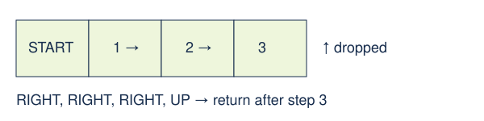

# Checked requested movement

> Markdown twin of [rejected-movement-stride-v1.html](../rejected-movement-stride-v1.html), generated from the HTML by `just explainer-twins`. The HTML is the source; edit it, not this file.

Frontier E6 and E8 show repeated one-tile cuts. This treatment executes one safe straight prefix of the directions the model requested. Correctness is tested; gameplay benefit is unmeasured.

## One call, one prefix

Illustrative example: the native executor checks before every step. No turn or second stride follows in the same call.

## Switch contract

| OFF | ON |
|---|---|
| Existing zero-input guard refusal, or one direction when rejected-movement-step-v1 is ON. | Under the original guard, supersedes the one-step fallback. Reuses safe-navigation-strides-v1; one straight prefix, at most eight tiles, then returns. |

When rejected-movement-prefix-v1 is also ON, that switch takes precedence and uses its existing checked per-direction presses. The straight native-stride behavior and receipt described here apply when prefix is OFF. The six current bundle recipes enable prefix as well as this switch.

Ends before grass, objects, warps, script coordinates, unknown geometry, elevation changes or a bend. No verified corridor means zero inputs. Single presses and interaction batches keep their previous behavior.

## Receipts and safety

The model receives requested, submitted and dropped directions plus a terminal native receipt giving actual completed tiles and stop reason. Submitted means handed to the checked executor; an interruption can complete fewer tiles. The remainder is discarded.

Production factory → default-OFF feature → original movement guard → existing planStride → native /pokebench/stride → terminal receipt → observation. A second state check rejects stale geometry before submission. Native battle, script or map changes stop execution.

Game grounding: pret/pokeemerald revision 731ad5bfd6e6f265508d0efcca0ba42f9dcf5881; existing native stride executor uses field control and stationary endpoints. No new RAM addresses or story facts. Trigger navigation remains a separate switch and can enter a model-selected trigger endpoint; this direction prefix stops before it.

## Status

Default OFF. Prepared bundle ON, control OFF. Pending unapproved experiment only. No measured run, gameplay probe or service restart. Synthetic tests establish bounded execution, not speedup.
