Feature switch · observation · `respawn-readout-v1` · default OFF · bundle arm only · pending experiment

# Respawn readout

> Markdown twin of [respawn-readout-v1.html](../respawn-readout-v1.html), generated from the HTML by `just explainer-twins`. The HTML is the source; edit it, not this file.

One readout line, right after `Money:`, says where the player wakes up if the party faints, how many map changes that is from here, and how much money it costs. When this map has a POKéMON CENTER that would move that point, the line names it and its door.

## Why

Run `2026-10-20T13-54-28_qwen36-gpu0_b300` reached the Rustboro Gym and never entered a POKéMON CENTER (game stat `used_pokecenter 0`). It walked past the center door at (16,38), beat JOSH and TOMMY, lost to HIKER MARC and woke up in its bedroom in Littleroot. Nothing it read said where a blackout would send it.

| Seq | What happened | Saved heal location (RAM) |
|---|---|---|
| 14724 | Enters RUSTBORO CITY, TORCHIC 25/33; the exits list the center at (16,38) | BRENDANS HOUSE 2F (1/1) at (4,2) |
| 15195 | After JOSH in the gym, TORCHIC 11/35 | same |
| 15755 | Whited out; wakes in the bedroom (seq 15776 is its next turn) | same |

## What the model reads

Re-rendered from b300's raw RAM with the run's own server switches plus this one. Lines above and below are unchanged.

**OFF** (today), state seq 14716, the turn of seq 14724:

```
Money: ₽6284
Badges: none
```

**ON**, the same state:

```
Money: ₽6284
If your party faints, you wake up at your house in LITTLEROOT TOWN (8 map changes from here) and lose half your money (₽3142 of ₽6284). This town has a POKéMON CENTER you have not entered: RUSTBORO CITY POKEMON CENTER 1F at (16,38). Entering a POKéMON CENTER makes it the place you wake up if your party faints.
Badges: none
```

State seq 15196, in the gym right after JOSH (seq 15195). The gym's exits lead only to RUSTBORO CITY, so there is no second sentence:

```
Money: ₽6444
If your party faints, you wake up at your house in LITTLEROOT TOWN (9 map changes from here) and lose half your money (₽3222 of ₽6444).
```

State seq 15755, back in the bedroom after the blackout (seq 15776's turn):

```
Money: ₽3286
If your party faints, you wake up at your house in LITTLEROOT TOWN (on this map) and lose half your money (₽1643 of ₽3286).
```

## How the map changes are counted



*Fewest map changes over the game's map table, from b300's raw RAM. The respawn map is the bedroom (2F), so the gym reads 9. heal-before-trainers-v1 counts the same way but to the house 1F, where MOM is, which is why its seq 15195 warning said 8.*

The count is a port of `hopsFrom` in `packages/agent/src/low-hp-trainer-warning.ts`: the readout is rendered by the game server, which cannot call the agent's TypeScript. It counts map changes in the table, not whether every one is walkable now. At 0 the line says `(on this map)`; when no path exists in the table the distance is left out.

## Game grounding (pret/pokeemerald 731ad5b)

| Fact | Source | Used as |
|---|---|---|
| `SaveBlock1.lastHealLocation` at +0x1C: s8 mapGroup, s8 mapNum, s8 warpId, pad, s16 x, s16 y | `include/global.h` (`struct WarpData`) | the map and tile you wake on |
| Every center 1F runs `setrespawn HEAL_LOCATION_<TOWN>` in its OnTransition (17 maps, including the POKéMON LEAGUE 1F and the BATTLE FRONTIER center); the truck and the Hall of Fame set the bedroom | `data/maps/*/scripts.inc`, `SetLastHealLocationWarp` in `src/overworld.c` | entering a center moves the respawn point |
| A center's heal location is the town tile below its door: RUSTBORO CITY (16,39), door (16,38); the bedroom is house 2F (4,2) | `src/data/heal_locations.json` | "outside the POKéMON CENTER in RUSTBORO CITY"; "at your house in LITTLEROOT TOWN" |
| `DoWhiteOut`: `SetMoney(money / 2)`, `HealPlayerParty`, warp to lastHealLocation | `src/overworld.c` | the loss is `money − money / 2` (₽3222 of ₽6444; ₽3223 of ₽6445). Emerald has no badge or level rule. |
| After the warp no field text is shown (`FieldCB_WarpExitFadeFromBlack`); in battle the game says "is out of usable POKéMON!" and "whited out!" | `src/overworld.c`, `sText_PlayerWhiteout` in `src/battle_message.c` | The operator's wording "If your party faints, you wake up …" |

## The second sentence

For each warp of the current map that leads to a center 1F whose heal location is not the saved one (or when the player stands in such a center), one sentence, then once: "Entering a POKéMON CENTER makes it the place you wake up if your party faints." "This town has" when the center belongs to the town the player is in, else "An exit here leads to".

| What the game server saw | Sentence |
|---|---|
| The game from before the save existed, and never that center | This town has a POKéMON CENTER you have not entered: RUSTBORO CITY POKEMON CENTER 1F at (16,38). |
| The game from before the save existed, and that center entered earlier (the player stood in it, or a saved heal location pointed at it) | This town has a POKéMON CENTER you entered before, but it is no longer where you wake up: … at (16,38). |
| Not the whole game (a checkpoint start, or a re-render of one archive) | This town has a POKéMON CENTER that is not where you wake up: … at (16,38). |
| Standing in such a center (before its OnTransition has run) | You are in … , and it is not yet where you wake up. |

No RAM records which centers were entered, so "not entered" is claimed only when the server's own history covers the whole game.

## Wiring


*The game server applies the switch. The state JSON is unchanged either way; the facts reach the model only as this line. No event is recorded and the timeline is untouched: the line is an observation, recorded with the readout.*

## Status

- Default OFF; bundle arm only; pending experiment `experiments/respawn-readout.json`, not queued.
- Checks: `just test`, `just lint`, `just build`, `just coverage` (≥90 on both stacks); b300 replay above.
- Not done: measured runs. Review status is in the worklog.
