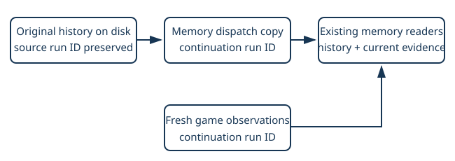

# Restored live memory

> Markdown twin of [restored-memory-run-v1.html](../restored-memory-run-v1.html), generated from the HTML by `just explainer-twins`. The HTML is the source; edit it, not this file.

A continuation keeps its history and follows new observations.

## The failure

Historical events carry the original run ID. Memory readers bind to that ID and reject observations from a new continuation ID. An old supervisor location can therefore appear after a correct current tool result.

## What changes

Only the historical envelope passed to memory consumers changes. Original prefix bytes, conversation, event sequence, timestamps, raw RAM and scoring remain preserved.

## On and off

**ON:** restored memory readers and new observations use the continuation namespace. Fresh location and dialogue evidence can update memory; consumed supervisor notes can expire normally.

**OFF:** replay uses the original source identities, exactly reproducing the prior behavior. The switch defaults off for ordinary presets. Future autoresearch qualification can explicitly enable it equally across prompt arms.

## Evidence and limits

A production-factory regression restores a gym observation, delivers a fresh Devon observation and checks supervisor expiry, updated instruction memory and preserved historical dialogue. Original prefix bytes remain identical. This is a correctness repair; it supplies no battle advice and establishes no measured gameplay improvement.

Tests, review, landing, qualification and launch are separate states. The failed campaign stays in its original form.
