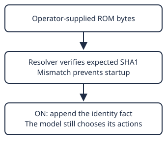

# ROM identity

> Markdown twin of [rom-identity-v1.html](../rom-identity-v1.html), generated from the HTML by `just explainer-twins`. The HTML is the source; edit it, not this file.

## What the switch says

With rom-identity-v1 ON, the final system-prompt paragraph is:

> This is standard Pokémon Emerald running from a hash-verified, unmodified ROM. No ROM hacks, randomizer, or custom story changes are applied.

This is the exact tested text. OFF preserves the previous prompt byte for byte. Tools, actions and game state do not change. Generic defaults remain OFF; both future current-recipe arms enable it by operator choice.

## Why this fact is grounded

The resolver requires SHA1 `f3ae088181bf583e55daf962a92bb46f4f1d07b7`. A surprising observation does not establish a changed ROM. Harness interpretations can still be wrong; this statement does not make inferred goals infallible.

## Evidence and limits

In one exploratory choice, the house proposal increased from 2/8 to 4/8; a routine exit control stayed 8/8 in both arms. This weak signal is not proof of reliable gameplay benefit. Successful samples could still invent story details. The study tested proposed next tool calls, not executed recovery or later rejection of a hacked-ROM belief.

Earlier GLM traces called ordinary player-house naming and the standard 20×20 Oldale map evidence of a modified game. The factual statement removes that unsupported premise without supplying the next route. Additional instructions about revising mistaken beliefs require their own evaluation.
