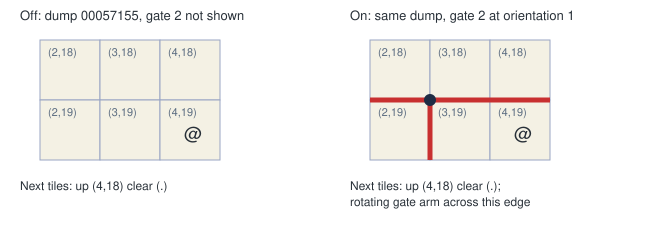
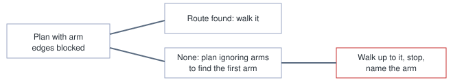
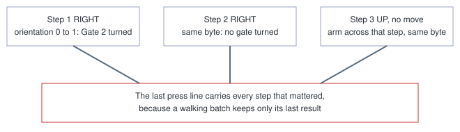

# Rotating gate readouts

> Markdown twin of [rotating-gate-readouts-v1.html](../rotating-gate-readouts-v1.html), generated from the HTML by `just explainer-twins`. The HTML is the source; edit it, not this file.

Five switches fix what a model sees and what `navigate_to` does in FORTREE CITY GYM and the TRICK HOUSE gate puzzle. All are registered default off. None chooses a push.

## Why

Run 274b entered the gym at turn 2043. The readout said a gate was "transitioning" whenever its sprite's `affineAnimEnded` bit was clear. A loaded gate that has never turned sits at byte `0x3F = 0x50`, with that bit clear, for as long as it stays on screen. So every unpushed gate near the player vanished from the map, and Next tiles called the arm's edge clear.

The orientation byte at saveblock1+0x139C was right all along, and it is what the game's collision reads.



*The pivot is the corner where four tiles meet. Arms lie on the lines between tiles, so no tile is occupied. This is gate 2 from run 274b.*

## The switches

| Switch | On | Off |
|---|---|---|
| `rotating-gate-positions-v1` | Every gate from its orientation byte, on screen or not. No sprite read, no transitioning state. ROM signature and live-owner checks stay. | Sprite-gated reading |
| `rotating-gate-rules-v1` | A short rules block, only on a map with gates. Never in the system prompt. | No block |
| `rotating-gate-map-v1` | One line per gate. The key names only glyphs the grid draws. | Old key, legend and Now lines |
| `map-code-aliases-v1` | One Codes letter per element token | One letter per glyph and token pair |
| `rotating-gate-navigation-v1` | Arm edges blocked in the plan; stops before an arm and names it | Gates do not affect the plan |
| `rotating-gate-press-feedback-v1` | A press with a direction says which gate turned, or that the arm across that step did not turn, or that no gate turned | No gate text in press results |

## The game's rules

From `src/rotating_gate.c` at pokeemerald 731ad5bf:

- `CheckForRotatingGatePuzzleCollision`: a step across an arm's line turns the gate if it can, and the step goes through. If it cannot turn, the step is refused.
- `sRotatingGate_RotationInfo*`: the arm always moves the way the player walks.
- `RotatingGate_CanRotate`: any arm sweeping into a tile with collision 1 stops the gate.

```
Gates on this map: a gate is movable. Its arms lie on the lines between tiles, and its pivot is a corner where four tiles meet, not a tile you can stand on. Walking into an arm pushes it around in the direction you walk: the whole gate turns 90 degrees around its pivot and you step through. It will not turn if an arm would sweep into a wall, and then you do not move.
```

The block never says which push to make or what a push would lead to. The model works that out.

## What navigate_to does



*If no route exists even ignoring arms, the usual refusal stands. Pushing is always the model's own press.*

```
Navigation: walked from (1,4) to (1,2), then stopped: gate 2's arm between (1,1) and (1,2) is across the route to (1,1); navigate_to does not push gates
```

## What press says

Run 5f0f compared eight gate lines by hand and got turns 1961, 1987 and 1997 wrong. A refused push read only "blocked or unavailable". With `rotating-gate-press-feedback-v1` the press result compares the orientation byte in the reads before and after each step. The game prints nothing when a gate turns, so the line is the plain fact.



*Comparing per step means two pushes that cancel inside one batch both show. The batch's first and last reads alone would match.*

| Case | Text added to the press result |
|---|---|
| A gate turned | `Gate 1 turned 90 degrees clockwise (arms north, south, west -> north, east, west)` |
| The player did not move and an arm is across that step | `Gate 1's arm between (8,14) and (9,14) did not turn` |
| A step that met no arm | `no gate turned` |
| A walking batch | `gates by step: step 3 RIGHT: Gate 1 turned 90 degrees clockwise (arms north, south, west -> north, east, west); no gate turned on the other steps` |
| A batch sent at once, with two reads only | `across this batch, Gate 1 turned ...`, or `no gate differs between the states before and after this batch; gate state was not read between its inputs` |
| A read is missing | `gate state unavailable, so whether a gate turned is not known` |

It only appears for a press with a direction from a free field on a map with gates. It gives no cause for a refusal and never names a push. navigate_to results do not change: under `rotating-gate-navigation-v1` it stops before arms and cannot turn a gate.

Replayed over the recorded 5f0f reads for turns 1955 to 2058: 92 press calls, 26 with a turn, none unreadable. The example lines above are from turns 1983, 1984 and 2013.

## Status

Not landed. Replayed on 274b dumps 00057101, 00057155, 00057425 and 00057467: all eight gates listed, orientations equal to the raw bytes, gate 2's arms present before any push. All five switches are on in both arms of the current recipe on this branch. No game run has used them yet.
