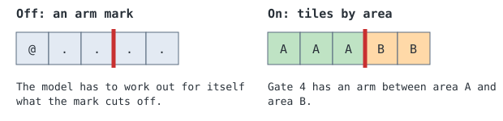
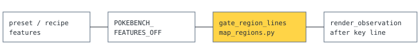

# Rotating gate areas

> Markdown twin of [rotating-gate-regions-v1.html](../rotating-gate-regions-v1.html), generated from the HTML by `just explainer-twins`. The HTML is the source; edit it, not this file.

`rotating-gate-regions-v1` adds one block to the readout on maps with rotating gates. It letters every walkable tile by the area it connects to with the gates as they stand. It says what is connected now and never which gate to push.

## Why it exists

A probe in `runs/probes/gym-map-format-20261105` asked models which tiles they could reach on 8 recorded Fortree Gym turns.

**8 of 63** right from the current map with its arm marks

**57 of 64** right with the lettered area grid

## What changes on the map



*Illustration. Walking into an arm turns the gate, so the tiles on its two sides do not connect as they stand. The map above the block is unchanged; the block is added after the map key line.*

## A real block

Actual output for run 3332, turn 15, in Fortree Gym, re-rendered from its recorded RAM with the branch's server code. Gate lines shortened after the fourth.

```
Walkable areas with the gates as they stand now. Tiles with the same letter connect without turning any gate. You are in area A.
 0  # # # # # # # # # # # # # # # # # # # #
 1  # # # # H H # # # # # # # # # # # # # #
 2  # # H H H H # # # # # # # # D D D # # #
 3  # # H # I I # # # # D D D # D D D # # #
 4  # # H # I I D D D D D D D D D D D D # #
 5  # # H # I I # # # # # # # D D D D D # #
 6  # C C # # I # # # # # # # # # # # # # #
 7  # C C # # C C C # # # # # E E E E E # #
 8  # C C C C C C C # C # # # E E E E E # #
 9  # C # # # C C C C C C # # E E E E E # #
10  # C # # # # C C C C C # # E E E E E # #
11  # # # # # # # # # C # # # E E E E E # #
12  # # # # # # # A A J # # # # # # # # # #
13  # # # # # # # A # J # # # F F F F F # #
14  # # # # # # # A A J # # # F F F F F # #
15  # # # # A # # A A # # # # F F F F F # #
16  # # # # A A A A A # # # # F F F F F # #
17  # # A A A # # A # # # # # # # # # # # #
18  # # A # A A A A # # # # # B B B B B # #
19  # # A A A # # # # # # # # B B B B B # #
20  # # A A A # # # # # # # # B B B B B # #
21  # # A A A # # G G G # B B B # B B # # #
22  # # # A A A G G G G G G B B B B B B # #
23  # # # # # G G G # # # # # B B B B B # #
24  # # # # # # # # # # # # # # # B B # # #
Gate 0 has an arm between area C and area I.
Gate 1 has an arm between area A and area J.
Gate 3 has an arm between area C and area H.
Gate 4 has an arm between area A and area J.
…
A ledge hops one way from area D to area E.
A ledge hops one way from area E to area F.
A ledge hops one way from area F to area B.
```

## What counts as walkable

The prototype used the game's collision bytes and drew ledges as walls. The switch uses the harness's own section rules (`map_sections.build_sections`) on the live full map instead.

| On the map | In the grid |
|---|---|
| Collision or water | `#` |
| Live object, such as a trainer | `#`; it can split a corridor into two areas |
| Gate arm | A refused step, in both directions, and a line if the two sides differ |
| Edge wall or elevation mismatch | A refused step, as everywhere else in the harness |
| Ledge | The ledge tile is `#`. The hop is one way, so the two sides stay separate areas with a "A ledge hops one way" line. If they also connect another way they are one area. |
| Warp | Nothing walks through it. It takes the letter of the one area it opens onto, otherwise `#`. A player standing on one is in that area. |

Same letter means each tile can walk to the other. `A` is always the player's area; the rest are lettered by size, so letters can change when a gate turns.

## When there is no block

- Any other map. Only Fortree Gym (12/1) and the Trick House gate puzzle (29/8) have rotating gates.
- A gate whose arms were not read, for example a failed memory read. A missing arm would join two areas that are not joined, so the whole block is left out and the existing "Map detail unavailable" line stands.
- A local map view rather than the full map.
- A player tile that belongs to no area.

## Wiring



*A server switch. It needs `rotating-gate-positions-v1`, which reads every gate from its orientation byte. Off, the readout bytes are as before.*

## Status

Registered default off, on in both arms of the recipe and in `current-control-24h-8k`. Replaying the 8 probe turns gives the same areas and gate lines as the prototype, plus the ledge lines. No game run has used it yet, and the Trick House map has not been exercised on real data. See the sibling [gate readouts explainer](rotating-gate-readouts-v1.md) for how gates are read.
