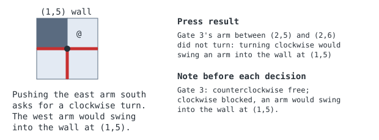

# Gate turns and push log

> Markdown twin of [rotating-gate-turns-log-v1.html](../rotating-gate-turns-log-v1.html), generated from the HTML by `just explainer-twins`. The HTML is the source; edit it, not this file.

Two switches for maps with rotating gates. `rotating-gate-turn-reasons-v1` says which way each gate can turn and why a push was refused. `rotating-gate-push-log-v1` keeps a record of every push. Neither says which gate to push, where to stand or what position to aim for.

## Why they exist

DeepSeek run 08b5 read "did not turn" as a gate that cannot move at all. Only one direction was refused, and the other was free from a tile it never tried. It also forgot what its own pushes had done once those turns left its context.

**Every** recorded refused push in 08b5 and Astra 4d66 names a wall when replayed through this code

## What the model gets



*The check is the game's own `RotatingGate_CanRotate`, run over the arms and collision already in the state.*

## The push log

Below the turns, the same note lists what has happened on this map, oldest first:

```
Turn 13: entered FORTREE CITY GYM: all gates at their starting positions.
Turn 15: LEFT from (12,22) to (11,22): Gate 6 turned 90 degrees clockwise (arms north, east, south -> east, south, west)
Turn 23: UP at (9,12): Gate 4's arm between (9,11) and (9,12) did not turn: turning counterclockwise would swing an arm into the wall at (8,11)
```

It is built from recorded `state` and `button_press` events, so trimming the context cannot lose it. Entries to the map are plain observations; there is no separate rule that leaving resets the gates.

## How the note is delivered

- It is added to the end of each request on a gate map and recorded whole as `ledger_context`.
- It is not kept in history, so a long log costs one copy, not one per message.
- It shows the newest 200 whole lines and says how many older lines are not shown, because the note sits outside the context fitter. The whole 08b5 log was 107 lines after two hours, so a normal run shows all of it.
- If a gate or a swept tile was not read, it claims nothing about turns.

## Switches

| Switch | On | Off |
|---|---|---|
| `rotating-gate-turn-reasons-v1` | Turn lines in the note, and the wall in a refused press | No note; press says only that the arm did not turn |
| `rotating-gate-push-log-v1` | Log lines in the note. Needs turn reasons | No log |

Both are registered off and on in both arms of `current.json`. A run already live keeps its own pin and does not get them.
