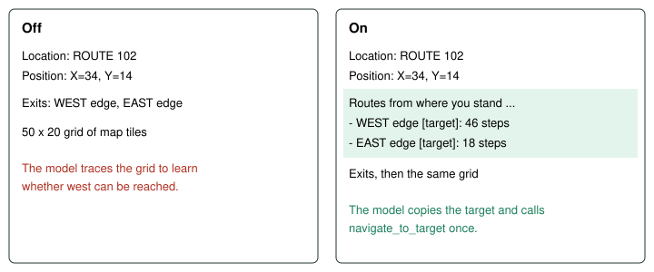
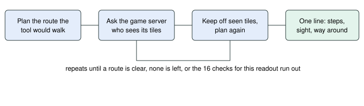

# Route Summary

> Markdown twin of [route-summary-v1.html](../route-summary-v1.html), generated from the HTML by `just explainer-twins`. The HTML is the source; edit it, not this file.

`route-summary-v1`. Default off in both arms. It tells the model what the pathfinder already knows, so it does not trace the map grid by hand.

## The problem

Qwen spent 10-41% of its output tokens drawing the ASCII map column by column. At run 6056 turn 121 it traced row 14 for thousands of tokens and hit the 8,192-token cap with no tool call, while the readout already listed the west exit as a target.

**10-41%** of output tokens went to redrawing the grid

## What the model reads

Run 6056 turn 120, on Route 102 at (34,14), with the switch off and on.

*The block goes right under the Position line. Everything else stays byte for byte.*

## How each line is worked out

| Line ends with | Meaning |
|---|---|
| out of every unbeaten trainer's sight | The route is clear. |
| crosses the sight of object 3 ...; 52 steps out of their sight | The direct route is seen; a longer one is not. |
| no route out of sight | Every route was tried and each is seen. |
| a route out of sight was not checked | The check limit ran out first. |
| trainer sight not checked | The server could not check, or the limit ran out. |
| 1 step to (1,0), then press A facing (2,0) to use Surf | The way crosses water. The tool walks to the shore and the A press is the model's own. Trainer sight is checked only as far as the shore, and the line says so. |
| no route navigate_to_target can walk from here | The planner finds nothing now. A person standing in a corridor can cause this, so the server's exit list may still call it reachable on foot. |

## Limits

At most 12 lines, whole lines only: guide tiles, then map edges, then warps, then the nearest others, and "N more left out." for the rest. No block appears while field controls are locked, because the planner refuses every route then, and that is not the same as no route. A guide tile counts only when the guide row is about the current map. The switch needs `full-map-navigation-v1`.

The block and the system prompt also say: navigate_to and navigate_to_target find their own path around walls, ledges and water, so give the final tile or target, not stepping stones; you do not need to trace the grid.

Off: no block and no sentence.
