# Route 103 rival splits

> Markdown twin of [route103-rival-splits-v1.html](../route103-rival-splits-v1.html), generated from the HTML by `just explainer-twins`. The HTML is the source; edit it, not this file.

Feature `route103-rival-splits-v1` adds five frontier points between **Route 103** and **Pokédex**. Before it, the frontier jumped from reaching Route 103 straight to one point called "Rival battle", which in fact fires only after the rival's post-battle talk. All five are measurement only: the model is never told about them.

## What the game records, in order

*About 3,100 frames separate the start of the battle from the win, and about 380 more separate the win from the flag the old split used.*

## The rules

| Split | Game state (pokeemerald 731ad5bf) | Does not count |
|---|---|---|
| Rival battle starts  `RIVAL_BATTLE_STARTED` | In battle, `gBattleTypeFlags` has the trainer bit, and `gTrainerBattleOpponent_A` is one of the six Route 103 rival trainers (Brendan or May with each starter, IDs 520–535) | Wild battles, other trainers, the id left over after the battle |
| Rival beaten  `RIVAL_BATTLE_DEFEATED` | That trainer's defeated flag (0x500 + id), set when the battle is won | The scene flag 0x82 |
| Rival sends you back  `RIVAL_BATTLE_WON` (unchanged) | `FLAG_DEFEATED_RIVAL_ROUTE103`, set by `Route103_EventScript_RivalEnd` after the talk |  |
| Rival waits in Oldale  `RIVAL_OLDALE_SEND_OFF` | `VAR_OLDALE_RIVAL_STATE` 1, then 2, on two settled Oldale states (`OldaleTown_EventScript_RivalFinish`) | Littleroot's own transition also sets 2; that never counts |
| Route 101, heading back  `ROUTE_101_AFTER_RIVAL_BATTLE` | A settled state before the battle (lab 0–3), then Oldale and Route 101 at lab 4 | A save that starts after the battle |
| Back in Littleroot  `LITTLEROOT_AFTER_RIVAL_BATTLE` | The same witness, then Route 101 and Littleroot at lab 4 | Later trips |

Each split fires once per run, at its first qualifying state. Loading and unknown screens are never used as evidence.

**Rival battle starts** marks reaching the battle, so it also counts a battle the player then loses. A rematch after a loss gives no second credit. Winning is **Rival beaten**, which the game sets only on a win (`CB2_EndTrainerBattle`).

A run's furthest milestone can now be one of these splits. The two battle splits sit between `ROUTE_103` and `RIVAL_BATTLE_WON`, so a run that loses or stalls in the battle now reports `RIVAL_BATTLE_STARTED` where an older run would report `ROUTE_103`. The other three sit between `RIVAL_BATTLE_WON` and `RECEIVED_POKEDEX`. Compare furthest milestones against older runs with that in mind.

## Where the data comes from

| Path | Effect |
|---|---|
| Python reader | New `route103_rival` field (`battle_active`, `defeated`, `oldale_stage`) next to `game_stats` |
| Readout text the model reads | Unchanged byte for byte |
| Loop guard progress fingerprint | Unchanged: it reads `story`, and the new field is outside it |
| Hints, stall clocks, objective record, STOP AT targets | The five splits are in the measurement-only set, so all of them ignore or refuse them |

## Older runs

The viewer derives **Route 101, heading back** and **Back in Littleroot** from recorded Birch lab states for runs that predate the feature. The other three need the new reader field, so older runs show them as not recorded.

## Status

Landed on main at `3307db77` after Claude, Grok and Codex review, with the fixture fix at `2cb0e316`. No measured run had recorded the new field when this was written.
