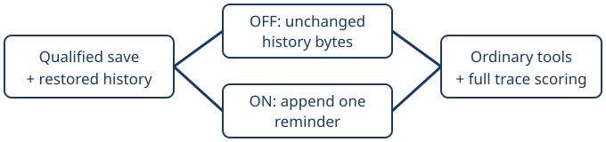

# Roxanne campaign reminder

> Markdown twin of [roxanne-campaign-reminder-v1.html](../roxanne-campaign-reminder-v1.html), generated from the HTML by `just explainer-twins`. The HTML is the source; edit it, not this file.

roxanne-campaign-reminder-v1 · default OFF · offline implementation

## One reminder, then ordinary decisions

The candidate arm appends one bounded strategy reminder after restored history. The model chooses its actions. The baseline receives the same qualified checkpoint and history with no reminder.

## What must qualify

The save must match native memory and CPU registers after the normal load. The receipt binds the checkpoint, clock, event prefix, system prompt, tools, and historical messages. Persistent history is separated from temporary request notes to prevent duplicate memory on later turns.

Original historical HTTP request bodies were not retained. The baseline is explicitly a validated reconstruction, not a claim of original wire-byte identity. Production first-context parity is checked separately.

## What counts as improvement

A recovery requires leaving the gym, gaining a Pokémon, level, evolution or moveset outside it, then starting another Roxanne battle with that capability. Healing, party reordering and a stated plan do not qualify. Earlier unchanged rematches are recorded separately.

## Evidence and launch boundary

The offline controller freezes batches, records every terminal trace, masks only the inserted reminder for grading, and keeps protected validation separate from revision. Fake-clock rehearsals demonstrate control flow; they establish no model benefit. Campaign launch still requires Operator's authorization and a qualified launch host.
