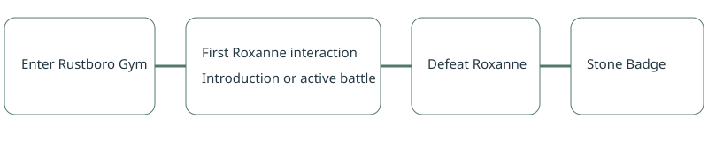

POKÉBENCH · MEASUREMENT

# First interaction with Roxanne

> Markdown twin of [roxanne-first-interaction-v1.html](../roxanne-first-interaction-v1.html), generated from the HTML by `just explainer-twins`. The HTML is the source; edit it, not this file.

A run gets credit for reaching Roxanne’s introduction even if it later loses the battle.

## What counts

The native game state shows her opening introduction while field input is locked and a message is active, or a trainer battle is active against trainer 265 in Rustboro Gym. This records once per run. Standing next to her and an old opponent ID do not count.

Measurement only: no new model guidance, objectives, stall-clock reset, game inputs or save changes. This is declared as `roxanne-first-interaction-v1` in new run metadata.

## Historical recovery

Older logs use the same native predicate. When only screenshots establish the interaction, the viewer verifies their event sequences, image hashes and full event-log hash. Recovered times are observation-time upper bounds, marked ≤. Originals remain unchanged; missing evidence remains missing.

## Game source

pret/pokeemerald revision `731ad5bfd6e6f265508d0efcca0ba42f9dcf5881`, `RustboroCity_Gym_EventScript_Roxanne` and `RustboroCity_Gym_Text_RoxanneIntro`. Existing verified readers supply the dialogue and trainer identity; this change introduces no RAM addresses.
